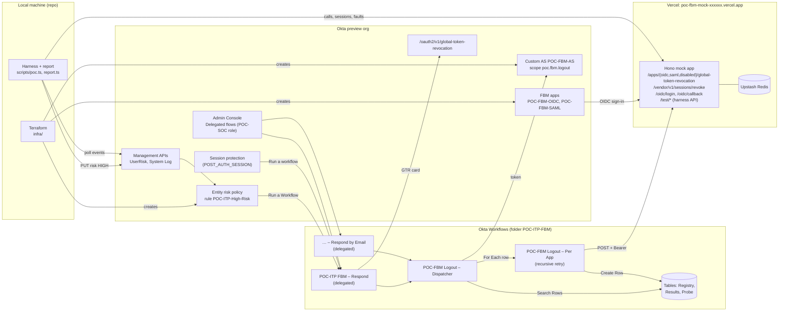

# POC plan: ITP Universal Logout for FBM apps (Option A)

Planned 2026-10-27. Source of truth for the design: [docs/itp-fbm-option-a-guide.md](itp-fbm-option-a-guide.md) (the guide). The executor works from this file, [CLAUDE.md](../CLAUDE.md), the guide, the build sheets in [docs/build-sheets/](build-sheets/), and the repo. Progress lives in [docs/PROGRESS.md](PROGRESS.md).

## 1. Summary

The POC proves, in a dedicated Okta preview org, that one delegated flow, `POC-ITP FBM – Respond`, can do what Universal Logout can't do for Federation Broker Mode (FBM) apps. The flow is triggered by ITP's entity risk rule, by session protection, or by a SOC admin. It runs the Okta ITP connector's Global Token Revocation card, then `POC-FBM Logout – Dispatcher`, which calls each enabled app in `POC-FBM Logout Registry`.

A mock in-house app on Vercel stands in for the FBM apps. It signs users in through the FBM OIDC test app, exposes a Global Token Revocation endpoint per app and a vendor-style revoke endpoint, and records every call so a local TypeScript harness can time and check each test. Okta objects are Terraform; Workflows flows are hand-built from card-by-card build sheets because Okta has no supported import API (F40).

### Inputs as resolved

| Input | Value |
| --- | --- |
| Org | Dedicated Okta preview org; URL goes in `.env` (`OKTA_ORG_URL`) at P1-T1 |
| ITP and Workflows plan | Confirmed at P1-T1. The plan fits Workflows Starter: at most 5 active flows (F39) |
| Okta credentials | A Super Administrator's SSWS API token for Terraform and setup scripts (plan change 2026-10-27: throwaway org, so no provisioner service app); OAuth 2.0 service app `POC-Harness` with private key JWT for tests (Terraform-created) |
| Language | TypeScript. Runtime is **Node 24, not Node 20**: Vercel stopped deploying Node 20 functions on 2026-10-01 (F60). Local scripts use Node 24 too, so one runtime covers everything |
| Mock app host | Vercel, project default domain `https://<project>.vercel.app` |
| Real SaaS test tenant | None. The vendor branch is exercised against the mock's API-key endpoint |
| Burst test users | 25 |

### Success criteria

The design passes when T1, T3, and T4 each produce exactly one Global Token Revocation (status 204) and exactly one successful call to every enabled registry app (guide, Testing and validation). Per test:

| Test | Passes when |
| --- | --- |
| T1 Entity risk rule | One `policy.entity_risk.action` event for the user; one Respond run (one Probe row); GTR card status 204; OIDC, SAML, and vendor endpoints each get one call that returns 204; the disabled canary row gets none; the user's mock sessions are gone; the user's Okta dashboard tab returns to sign-in |
| T2 Risk after flow | The user's risk level is read at 0, 60, and 180 seconds after the last registry call and recorded. Always passes as data capture; it drives decision D-RISK |
| T3 Session protection | After a network change into the deny zone, `policy.auth_reevaluate.fail` is logged, Respond runs once, and the three FBM calls land |
| T4 SOC manual run | A `POC-SOC` admin runs Respond with a user ID: same checks as T1 except the risk-rule event. T4b: the email wrapper gives the same result. T4c: a run with an empty User ID makes no calls |
| T5 FBM OIDC tokens | Refresh tokens issued to the FBM OIDC app by the custom authorization server and by the org authorization server both fail to refresh after a T1-style run. If either survives, the sweep probe records which revocation call kills it (decision D-SWEEP) |
| T6 Latency | Seconds per step recorded for 4 runs (T1 plus 3). Okta-layer delay (`user.risk.detect` to GTR complete) is at most `POC_T6_MAX_SECONDS` (60) on every run and at most `POC_T6_MEDIAN_SECONDS` (30) at the median; otherwise decision D-FALLBACK triggers |
| T7 Burst | 25 users raised to High within 60 seconds; each user gets exactly one `policy.entity_risk.action`, one Respond run, and one successful call per enabled app; the injected 429s are retried; no Workflows execution is left In Progress 15 minutes after the burst |

## 2. Verified facts

Every fact below was checked against the cited page on 2026-10-27. Tasks refer to facts by ID.

### Okta APIs and policies

| ID | Fact | Source |
| --- | --- | --- |
| F1 | `GET /api/v1/users/{userId}/risk` (scope `okta.userRisk.read`) returns `{riskLevel, reason}`; `riskLevel` is HIGH, MEDIUM, LOW, or NONE | [UserRisk API](https://developer.okta.com/docs/api/openapi/okta-management/management/tag/UserRisk/) |
| F2 | `PUT /api/v1/users/{userId}/risk` (scope `okta.userRisk.manage`), body `{"riskLevel":"HIGH"}`; allowed values HIGH, MEDIUM, LOW; returns 200 or 201; 429 on rate limit | [UserRisk API](https://developer.okta.com/docs/api/openapi/okta-management/management/tag/UserRisk/) |
| F3 | Policy types `ENTITY_RISK` and `POST_AUTH_SESSION` are read-only policies, one of each per org. You can't create these policies. You can add rules to `ENTITY_RISK`, but you can't create additional rules for `POST_AUTH_SESSION` | [Policy API](https://developer.okta.com/docs/api/openapi/okta-management/management/tag/Policy/), [Entity risk policy](https://help.okta.com/oie/en-us/content/topics/itp/entity-risk-policy.htm) |
| F4 | Entity risk rule actions: `{"action":"TERMINATE_ALL_SESSIONS"}` or `{"action":"RUN_WORKFLOW","workflow":{"id":<integer>}}`; conditions `people.groups.include/exclude`, `people.users.include/exclude`, `entityRisk.level` | [Policy API](https://developer.okta.com/docs/api/openapi/okta-management/management/tag/Policy/) |
| F5 | `POST_AUTH_SESSION` rule: `conditions.people` only; `actions.postAuthSession.failureActions[]` takes `TERMINATE_SESSION` or `RUN_WORKFLOW` | [Policy API](https://developer.okta.com/docs/api/openapi/okta-management/management/tag/Policy/) |
| F6 | Session protection Status (Monitoring / Enforced) is set in the Admin Console under Security > Identity Threat Protection > Detection and Response > Session Protection. Enforcement settings offer Run an additional action > Run a workflow ("Only delegated Workflows are supported"), and Groups impacted limits only the additional action. No API field for Status was found | [Configure session protection](https://help.okta.com/oie/en-us/content/topics/itp/configure-session-protection.htm) |
| F7 | Session protection re-evaluates the global session policy and app sign-in policies when ITP sees an IP or device change; in Monitoring mode failures are only logged as `policy.auth_reevaluate.fail` | [Continuous access evaluation](https://help.okta.com/oie/en-us/content/Topics/itp/continuous-access-evaluation.htm) |
| F8 | FBM is the app setting `settings.implicitAssignment: true`; available only for custom SAML and OIDC apps; Universal Logout doesn't work for those apps while FBM is on; standard group assignments aren't supported | [Support: FBM via Apps API](https://support.okta.com/help/s/article/create-an-application-with-federation-broker-mode-enabled-using-apps-api), [FBM known limitations](https://help.okta.com/oie/en-us/content/topics/apps/apps-fbm-known-issues.htm) |
| F9 | `GET /api/v1/logs` (scope `okta.logs.read`): `since`, `until`, `after`, `filter` (SCIM, e.g. `eventType eq "x"`, `target.id eq "00u…"`), `limit` up to 1000, `sortOrder`. Polling = no `until`, ASCENDING, follow `rel=next` links; some events may be delayed | [System Log API](https://developer.okta.com/docs/api/openapi/okta-management/management/tag/SystemLog/), [System Log query guide](https://developer.okta.com/docs/reference/system-log-query/) |
| F10 | ITP System Log events: `user.risk.detect`, `policy.entity_risk.evaluate`, `policy.entity_risk.action`, `policy.auth_reevaluate.fail/.enforce/.action`, `user.session.context.change`, `user.session.end`, `user.session.clear`, `user.session.universal_logout`, `user.authentication.universal_logout`, `workflows.user.delegatedflow.run` | [ITP System Log events](https://help.okta.com/oie/en-us/content/topics/itp/system-log-events.htm) |
| F11 | Universal Logout request an app must accept: `POST`, `Authorization: Bearer <JWT>`, body `{"sub_id":{"format":"email","email":"…"}}` or `{"sub_id":{"format":"iss_sub","iss":"…","sub":"…"}}`. Responses: 204 success, 400 malformed or unknown subject type, 401 bad auth, 403 insufficient auth, 404 user not found, 422 couldn't log out. Okta reads only the status code | [Build Universal Logout for your app](https://developer.okta.com/docs/guides/oin-universal-logout-overview/) |
| F12 | Okta's signed request JWT: header `typ: global-token-revocation+jwt`; claims `jti`, `iss` (org URL), `sub` (OIDC client_id or SAML app instance ID), `aud` (endpoint URL), `exp` (+5 min), `nbf`, `iat`; signed with the key used for ID tokens or SAML assertions | [Build Universal Logout for your app](https://developer.okta.com/docs/guides/oin-universal-logout-overview/), [Express example](https://developer.okta.com/blog/2024/04/30/express-universal-logout) |
| F13 | `GET /api/v1/users/{userId}/clients` (scope `okta.users.read`); `DELETE /api/v1/users/{userId}/clients/{clientId}/tokens` (scope `okta.users.manage`) revokes all refresh tokens for that user and client | [User resources API](https://developer.okta.com/docs/api/openapi/okta-management/management/tag/UserResources/), [User OAuth API](https://developer.okta.com/docs/api/openapi/okta-management/management/tag/UserOAuth/) |
| F14 | `DELETE /api/v1/users/{userId}/sessions?oauthTokens=true` (scope `okta.users.manage`) revokes issued OIDC and OAuth refresh and access tokens | [User sessions API](https://developer.okta.com/docs/api/openapi/okta-management/management/tag/UserSessions/) |
| F15 | Service apps: `private_key_jwt` is the only client auth that can get Okta-scoped tokens; the app needs an admin role; client assertion `iss`=`sub`=client_id, `aud`=`https://{org}/oauth2/v1/token` | [OAuth for Okta service apps](https://developer.okta.com/docs/guides/implement-oauth-for-okta-serviceapp/main/) |
| F15a | SSWS API tokens inherit the privilege level of the admin who created them, are shown once, are valid for 30 days from creation or last use, can be restricted to a network range, and are deprovisioned when the creating account is deactivated. Okta recommends OAuth 2.0 over SSWS | [Create an API token](https://developer.okta.com/docs/guides/create-an-api-token/main/) |
| F16 | New service apps have "Require DPoP" on by default; turn it off under General Settings > Proof of possession | [Okta KB: use_dpop_nonce](https://support.okta.com/help/s/article/receiving-use-dpop-nonce-error-when-requesting-access-token), [DPoP blog](https://developer.okta.com/blog/2024/10/23/dpop-oauth-node) |
| F17 | Scope names used here: `okta.users.*`, `okta.groups.*`, `okta.apps.*`, `okta.appGrants.manage`, `okta.policies.*`, `okta.authorizationServers.*`, `okta.networkZones.*`, `okta.roles.*`, `okta.orgs.read`, `okta.schemas.read`, `okta.logs.read`, `okta.userRisk.read/manage`, `okta.universalLogout.manage` | [OAuth 2.0 scopes](https://developer.okta.com/docs/api/oauth2/) |
| F18 | Custom role permissions `okta.workflows.invoke` ("view and run delegated flows") and `okta.workflows.read`; `okta.users.risk.manage`, `okta.users.risk.read` | [Permissions guide](https://developer.okta.com/docs/api/openapi/okta-management/guides/permissions/) |
| F19 | Resource ORNs: delegated flows `orn:{partition}:workflow:{orgId}:flows:{flowId}`; users in a group `orn:{partition}:directory:{orgId}:groups:{groupId}:contained_resources` or `https://{org}/api/v1/groups/{groupId}/users`; `{partition}` is `oktapreview` for preview orgs | [Roles guide](https://developer.okta.com/docs/api/openapi/okta-management/guides/roles/) |
| F20 | Custom authorization server endpoints: `/oauth2/{asId}/v1/token`, `/oauth2/{asId}/v1/keys`; access token claims include `iss`, `aud`, `cid`, `scp`, `exp`; `alg` RS256 | [OAuth API overview](https://developer.okta.com/docs/api/openapi/okta-oauth/guides/overview/) |
| F21 | Client credentials needs a custom scope and a policy rule; such rules have no user | [Client credentials guide](https://developer.okta.com/docs/guides/implement-grant-type/clientcreds/main/), [Customize authorization server](https://developer.okta.com/docs/guides/customize-authz-server/main/) |
| F22 | **The Client Credentials grant option only appears if the org purchased or renewed an NHI Authentication Token subscription on or after August 14, 2026** | [Authorization server access policies](https://help.okta.com/oie/en-us/content/Topics/security/api-config-access-policies.htm) |
| F23 | `GET /.well-known/okta-organization` is unauthenticated and returns `id` and `_links.organization.href` | [Org setting metadata](https://developer.okta.com/docs/api/openapi/okta-management/management/tag/OrgSettingMetadata/) |
| F24 | Elevate risk in the console: Directory > People > user > More actions > Elevate Risk Level. "Okta changes the entity risk level to Low when the entity risk policy or the Clear user sessions action triggers Universal Logout" | [Manual actions](https://help.okta.com/oie/en-us/Content/Topics/itp/manual-actions.htm) |
| F25 | Universal Logout's revocation table marks nothing for custom authorization servers; a global session policy violation revokes only the violating device's session | [Universal Logout revocations](https://help.okta.com/oie/en-us/content/topics/itp/universal-logout-revocations.htm) |
| F26 | Rate-limit headers `X-Rate-Limit-Limit/Remaining/Reset`; 429 when exceeded; Okta recommends backoff | [Rate limit monitoring](https://developer.okta.com/docs/reference/rl2-monitor/) |
| F27 | Entity risk rule UI: group membership, Detection, Entity Risk Level, Take this action (No further action / Logout and revoke tokens / Run a Workflow > Workflow triggered by action); one delegated flow per rule; drag rules above the catch-all | [Add an entity risk policy rule](https://help.okta.com/oie/en-us/content/topics/itp/add-entity-risk-policy-rule.htm) |

### Terraform okta/okta provider (latest v7.0.0, 2026-08-24)

| ID | Fact | Source |
| --- | --- | --- |
| F28 | Provider auth by private key JWT: `org_name`, `base_url` (`oktapreview.com`), `client_id`, `private_key` (path or PEM), `private_key_id`, `scopes`; env vars `OKTA_ORG_NAME`, `OKTA_BASE_URL`, `OKTA_API_CLIENT_ID`, `OKTA_API_PRIVATE_KEY`, `OKTA_API_PRIVATE_KEY_ID`, `OKTA_API_SCOPES` (comma-separated) | [Provider docs](https://registry.terraform.io/providers/okta/okta/latest/docs) |
| F28a | Provider auth by API token: `api_token` (env `OKTA_API_TOKEN`) with `org_name` and `base_url`. It is mutually exclusive with `access_token`, `client_id`, `private_key_id`, `private_key`, and `scopes`. The docs call SSWS "a legacy authorization scheme" and name no resource that needs OAuth | [Provider docs](https://github.com/okta/terraform-provider-okta/blob/master/docs/index.md) |
| F29 | `okta_app_oauth` and `okta_app_saml` take `implicit_assignment` ("Enable Federation Broker Mode", Early Access) and `authentication_policy`. Open bug: `implicit_assignment = false` is never sent for OAuth apps, so FBM can't be turned off from Terraform (deleting the app is unaffected) | [app_oauth](https://registry.terraform.io/providers/okta/okta/latest/docs/resources/app_oauth), [app_saml](https://registry.terraform.io/providers/okta/okta/latest/docs/resources/app_saml), [issue 2967](https://github.com/okta/terraform-provider-okta/issues/2967) |
| F30 | `okta_app_oauth`: `type` (`web`, `service`, …), `grant_types`, `response_types`, `redirect_uris`, `pkce_required`, `token_endpoint_auth_method`, `jwks`, `dpop_bound_access_tokens`, `refresh_token_rotation`, `refresh_token_leeway`, `omit_secret`; outputs `client_id`, `client_secret` (sensitive). `skip_authentication_policy` added in 6.9.0 | [app_oauth](https://registry.terraform.io/providers/okta/okta/latest/docs/resources/app_oauth), [CHANGELOG](https://github.com/okta/terraform-provider-okta/blob/master/CHANGELOG.md) |
| F31 | `okta_app_signon_policy` (`name`, `description`, `catch_all` false makes the default rule DENY) and `okta_app_signon_policy_rule` (`access`, `factor_mode`, `constraints`, `groups_included`, `network_connection` ANYWHERE/ZONE/…, `network_includes`, `priority`, `re_authentication_frequency`) | [app_signon_policy](https://registry.terraform.io/providers/okta/okta/latest/docs/resources/app_signon_policy), [app_signon_policy_rule](https://registry.terraform.io/providers/okta/okta/latest/docs/resources/app_signon_policy_rule) |
| F32 | `okta_network_zone`: `name`, `type` = `IP`, `gateways` (CIDR set), `usage` (default `POLICY`) | [network_zone](https://registry.terraform.io/providers/okta/okta/latest/docs/resources/network_zone) |
| F33 | `okta_auth_server` (`audiences`, `issuer_mode`; exports `issuer`), `okta_auth_server_scope`, `okta_auth_server_policy` (`client_whitelist`), `okta_auth_server_policy_rule` (`grant_type_whitelist` incl. `client_credentials`, `authorization_code`; `scope_whitelist`; `group_whitelist`; `access_token_lifetime_minutes` 5–1440) | [auth_server_policy_rule](https://registry.terraform.io/providers/okta/okta/latest/docs/resources/auth_server_policy_rule) |
| F34 | `okta_app_oauth_api_scope` (`app_id`, `issuer`, `scopes`); `okta_app_oauth_role_assignment` (`client_id`, `type` standard or `CUSTOM`, `role`, `resource_set`), which "requires the Okta tenant feature flag" | [app_oauth_api_scope](https://registry.terraform.io/providers/okta/okta/latest/docs/resources/app_oauth_api_scope), [app_oauth_role_assignment](https://registry.terraform.io/providers/okta/okta/latest/docs/resources/app_oauth_role_assignment) |
| F35 | `okta_admin_role_custom` (`label`, `description`, `permissions`; documented list includes `okta.workflows.invoke`), `okta_resource_set` (`label`, `description`, `resources` as REST URLs or ORNs), `okta_admin_role_custom_assignments` (`resource_set_id`, `custom_role_id`, `members` hrefs) | [admin_role_custom](https://registry.terraform.io/providers/okta/okta/latest/docs/resources/admin_role_custom), [resource_set](https://registry.terraform.io/providers/okta/okta/latest/docs/resources/resource_set) |
| F36 | `data "okta_entity_risk_policy"` and `okta_entity_risk_policy_rule` (`policy_id`, `name`, `risk_level`, `priority`, `groups_included`, `users_excluded`, `terminate_all_sessions`, `workflow_id`) | [entity_risk_policy_rule](https://registry.terraform.io/providers/okta/okta/latest/docs/resources/entity_risk_policy_rule) |
| F37 | `okta_post_auth_session_policy_rule` can only be imported and updated; destroy removes it from state but leaves it in Okta. That's why this plan manages session protection with a snapshot-and-restore script, not Terraform | [post_auth_session_policy_rule](https://registry.terraform.io/providers/okta/okta/latest/docs/resources/post_auth_session_policy_rule) |
| F38 | `data "okta_org_metadata"` exports `id` and `domains.organization` | [org_metadata](https://registry.terraform.io/providers/okta/okta/latest/docs/data-sources/org_metadata) |

### Okta Workflows

| ID | Fact | Source |
| --- | --- | --- |
| F39 | Active flows: Starter 5, Light 50, Medium 150, Maximum unlimited. Okta connector: 30 concurrent requests, 6,000 per minute. Tables: 500,000 rows. Execution history kept 30 days | [Workflows system limits](https://help.okta.com/wf/en-us/Content/Topics/workflows/workflows-system-limits.htm) |
| F40 | Export and import is by `.flow` or `.folder` file in the console, which drops connections and table data; Okta has no public API to manage flows | [Export and import](https://help.okta.com/wf/en-us/content/topics/workflows/build/export-import-flows.htm), [Okta dev forum, 2025-11-19](https://devforum.okta.com/t/getting-workflow-configuration-through-management-api/34598) |
| F41 | Okta ITP connector cards: Global Token Revocation (input User ID, format opaque; output Status Code; 204 revoked, 403 missing permissions), Upsert User Risk (User ID, Risk Level Low/High), Retrieve User Risk, User Risk Detected event (Risk Level, Previous Level, Okta User {ID…}) | [Okta ITP connector](https://help.okta.com/wf/en-us/content/topics/workflows/connector-reference/oktaitp/oktaitp.htm), [Global Token Revocation](https://help.okta.com/wf/en-us/content/topics/workflows/connector-reference/oktaitp/actions/globaltokenrevocation.htm), [Upsert User Risk](https://help.okta.com/wf/en-us/content/topics/workflows/connector-reference/oktaitp/actions/upsertuserrisk.htm), [User Risk Detected](https://help.okta.com/wf/en-us/content/topics/workflows/connector-reference/oktaitp/events/userriskdetected.htm) |
| F42 | Delegated Flow event card: extensible Inputs (Text, Number, True or False, Date & Time), User Context > Okta User ID (the admin who runs it), Context > Caller {ID, Alternate ID, Display Name, Type}; the Run button is unavailable while a flow is off | [Build a delegated flow](https://help.okta.com/wf/en-us/content/topics/workflows/build/build-delegated-flow.htm), [KB: configure delegated workflows](https://support.okta.com/help/s/article/how-to-configure-delegated-workflows) |
| F43 | Running a delegated flow needs a custom admin role with Run delegated flow and a resource set that contains the flow; run from Admin Console > Workflows > Delegated flows > Run; System Log `workflows.user.delegatedflow.run` | [About delegated flows](https://help.okta.com/en-us/Content/Topics/automation-hooks/delegated-flows/about-delegated-flows.htm), [Run a delegated flow](https://help.okta.com/oie/en-us/content/Topics/automation-hooks/delegated-flows/run-delegated-flow.htm) |
| F44 | ITP supports only delegated flows; create the flow and turn it on before adding the rule | [ITP delegated flows](https://help.okta.com/oie/en-us/content/topics/itp/workflows-itp-create-delegated-flows.htm) |
| F45 | Function cards used: Call Flow (outputs created by hand with the helper's exact names and types), Return, For Each (`item`, static values, concurrency; no outputs), Object – Get (dot paths), Object – Construct, If/Else, If/ElseIf, Continue If, Lookup, Assign If, Assign, Wait For (seconds to days), Text – Compose, Text – Concatenate, Number – Add, Number – Multiply, Date & Time – Now, JSON – Parse, List – Pluck, List – Includes | [Function reference](https://help.okta.com/wf/en-us/content/topics/workflows/function-reference/functions.htm), [Call Flow](https://help.okta.com/wf/en-us/content/topics/workflows/function-reference/flow-control/flocontrol_spawn.htm), [For Each](https://help.okta.com/wf/en-us/content/topics/workflows/function-reference/list/list_each.htm) |
| F46 | Error Handling – If Error has Try and If Error sections and passes values out through View Outputs. Card-level retry happens only for HTTP 429; 400–422, 500, 503, and 504 aren't retried | [If Error](https://help.okta.com/wf/en-us/Content/Topics/Workflows/function-reference/Error-Handling/errorhandling_trycatch.htm), [Error handling](https://help.okta.com/wf/en-us/content/topics/workflows/build/set-error-handling.htm) |
| F47 | A helper flow can call itself (recursion) | [KB: recursion in Workflows](https://support.okta.com/help/s/article/set-up-recursion-in-workflows) |
| F48 | API Connector – Raw Request: URL, Method, Headers (object), Query, Body (text) → Status Code, Headers, Body; API Connector connection auth types Basic, Custom Header, OAuth, Client Credentials, None, stored securely | [Raw Request](https://help.okta.com/wf/en-us/content/topics/workflows/function-reference/http/http_raw.htm), [API Connector authorization](https://help.okta.com/wf/en-us/content/topics/workflows/function-reference/http/http_authorization.htm) |
| F49 | Tables: column types String, Number, Date, Boolean, Counter; Import reads CSV into defined columns; Export writes CSV; Search Rows (All matching rows, Where filter, max 3,500 rows); Create Row | [Create a table](https://help.okta.com/wf/en-us/Content/Topics/Workflows/build/create-table.htm), [Import from CSV](https://help.okta.com/wf/en-us/content/topics/workflows/build/import-from-csv.htm), [Search Rows](https://help.okta.com/wf/en-us/content/topics/workflows/function-reference/tables/stash_searchrows2.htm) |
| F50 | Okta – Read User (input ID or Login); Okta – Custom API Action (Request Type, Relative URL starting with `/`, Query, Body → Status Code, Headers, Body) | [Read User](https://help.okta.com/wf/en-us/content/topics/workflows/connector-reference/okta/actions/readuser.htm), [Custom API Action](https://help.okta.com/wf/en-us/content/topics/workflows/connector-reference/okta/actions/httprequest.htm) |
| F51 | Okta and ITP connections: Domain, Client ID, Client Secret, default or custom scopes; first authorization needs a super admin | [ITP connection](https://help.okta.com/wf/en-us/content/topics/workflows/connector-reference/oktaitp/overviews/authorization.htm) |
| F52 | Clearing the session of the account that authorized the Okta connection breaks the connection ("The refresh token is invalid or expired") | [Okta KB](https://support.okta.com/help/s/article/Okta-Workflows-connection-fails-with-The-refresh-token-is-invalid-or-expired-error-and-requires-reauthorization) |

### Vercel

| ID | Fact | Source |
| --- | --- | --- |
| F60 | Node.js 20 was deprecated for builds and functions on 2026-10-01; available versions are 24.x (default) and 22.x; pin with `"engines": {"node": "24.x"}` | [Node.js versions](https://vercel.com/docs/functions/runtimes/node-js/node-js-versions), [changelog](https://vercel.com/changelog/node-js-20-is-being-deprecated) |
| F61 | Hono deploys with zero configuration from `src/index.ts` with `export default app` | [Hono on Vercel](https://vercel.com/docs/frameworks/backend/hono) |
| F62 | Standard Protection (default) protects every deployment except production domains; the per-deployment URL that `vercel deploy` prints is protected. Check with `vercel project protection <name> --format json` | [Deployment Protection](https://vercel.com/docs/deployment-protection), [vercel project](https://vercel.com/docs/cli/project) |
| F63 | Vercel KV is gone; use Upstash for Redis from the Marketplace: `vercel integration add upstash/upstash-kv`; client `@upstash/redis`, whose `Redis.fromEnv()` reads `UPSTASH_REDIS_REST_*` or `KV_REST_API_*`. Remove with `vercel integration resource remove <name> --disconnect-all --yes` | [Vercel Redis](https://vercel.com/docs/redis), [vercel integration](https://vercel.com/docs/cli/integration), [redis-js fromEnv](https://raw.githubusercontent.com/upstash/redis-js/main/packages/redis/platforms/nodejs.ts) |
| F64 | CLI: `vercel link --yes --project <name>` (creates the project); `vercel env add NAME production --force` reads the value from stdin; `vercel deploy --prod --yes`; `vercel remove <project> --yes`; `VERCEL_TOKEN` env var | [link](https://vercel.com/docs/cli/link), [env](https://vercel.com/docs/cli/env), [deploy](https://vercel.com/docs/cli/deploy), [remove](https://vercel.com/docs/cli/remove), [global options](https://vercel.com/docs/cli/global-options) |
| F65 | Function instances don't share memory; keep state in an external store. Hobby: 300 s max duration; runtime logs kept 1 hour | [What is compute](https://vercel.com/docs/fundamentals/what-is-compute), [Runtime logs](https://vercel.com/docs/logs/runtime) |
| F66 | "Hobby teams are restricted to non-commercial personal use only" | [Fair use guidelines](https://vercel.com/docs/limits/fair-use-guidelines) |

## 3. Unverified assumptions

Each item has a POC default and the task that settles it. The executor records the outcome with `npm run finding -- set <key> <value>`; the report lists every key.

| ID | Assumption (POC default) | Settled by | Finding key |
| --- | --- | --- | --- |
| U1 | When ITP runs a delegated flow, it puts the at-risk user's ID either in the custom input `User ID` (outcome A) or in User Context > Okta User ID with Context > Caller populated (outcome B). Manual runs leave Caller empty | P7-T3 probe | `probe.outcome` |
| U2 | A delegated flow that is on appears in the entity risk rule's and session protection's flow lists with no further setup | P7-T3, P9-T2 | `probe.flowListed` |
| U3 | The rule's `workflow_id` is the numeric flow ID in the Workflows console URL | P7-T1 | `itp.workflowIdMatchesUrl` |
| U4 | The delegated-flow ORN uses the same flow ID | P7-T6 | `soc.ornWorks` |
| U5 | The flow ID appears in the Workflows flow URL as `/flows/<number>` | P6-T5 | `wf.flowIdSource` |
| U6 | A non-2xx response makes Raw Request error; inside If Error, the status code is at `statusCode` on the error object | P6-T4 scenario S2 | `wf.rawRequestErrorStatusPath` |
| U7 | Search Rows (All matching rows) returns row objects keyed by column name (`Method`, `App name`, …) | P6-T4 scenario S1 | `wf.searchRowsRowShape` |
| U8 | CSV import maps `true`/`false` into a Boolean column | P6-T1 | `wf.csvBooleanImport` |
| U9 | The Okta ITP connection's default scopes let Global Token Revocation return 204, not 403 | P8-T1 | `t1.gtrStatus` |
| U10 | Client Credentials is available on the custom authorization server in this org (see F22). If it isn't, the POC switches to a static bearer held in a Workflows connection | P3-T4, P3-T5 | `authz.clientCredentials` |
| U11 | An API Connector Basic connection sends credentials the Okta token endpoint accepts as `client_secret_basic` | P6-T4 scenario S1 | `wf.tokenViaBasicConnection` |
| U12 | Session protection's Groups impacted and Run a workflow appear in the API as the `POST_AUTH_SESSION` rule's `conditions.people.groups.include` and `RUN_WORKFLOW` | P9-T3 | `sp.uiMapsToApi` |
| U13 | A DENY rule for a network zone in the FBM apps' sign-in policy is enough for session protection to flag a violation after an IP change | P9-T4 (T3) | `t3.violationLogged` |
| U14 | Session protection Status applies to the whole org (docs don't say; treated as org-wide) | Not tested; org is dedicated | — |
| U15 | The custom authorization server issues refresh tokens to the FBM OIDC app with rule grant `authorization_code` plus the `offline_access` scope | P4-T3 | `oidc.refreshIssued.custom` |
| U16 | Okta's signed GTR JWT verifies against `{org}/oauth2/v1/keys` for OIDC apps. Not exercised: Okta never calls FBM apps; covered by unit tests only | P2-T2 (unit) | — |
| U17 | `okta_app_oauth_role_assignment` works in this org (F34 feature flag) | P3-T6 | `harness.roleAssignment` |
| U18 | `vercel integration add upstash/upstash-kv` needs interactive terms acceptance the first time (so it's a HUMAN task) | P2-T6 | — |
| U19 | The production domain is `https://<VERCEL_PROJECT_NAME>.vercel.app` and is public under Standard Protection | P2-T5 | `vercel.productionDomain` |
| U20 | Workflows exports the Results table's Date column in a format `Date.parse` accepts | P11-T2 | `wf.dateExportFormat` |
| U21 | Recursive Per App calls (depth up to 4) with Wait For work under a 25-user burst | P9-T5 (T7) | `t7.retriesOk` |
| U22 | System Log `target.id eq "<userId>"` returns the user's ITP events | P7-T2 | `syslog.targetFilterWorks` |
| U23 | The GTR card writes a System Log event; which type is unknown | P8-T1 | `t1.gtrEventTypes` |
| U24 | Lowering a user to LOW by API and raising to HIGH again re-triggers the entity risk rule | P7-T2 | `risk.reTriggerWorks` |
| U25 | `skip_authentication_policy` (in CHANGELOG 6.9.0, not on the docs page) is accepted on service apps | P3-T4 | — |
| U26 | API accepts `okta.workflows.invoke` as the Run delegated flow permission | P7-T5 | `soc.permissionName` |
| U27 | Okta – Read User finds a user when given the email, because login equals email for POC users | P8-T4 (T4b) | `t4b.readUserByEmail` |
| U28 | Vercel dashboard paths for tokens (Account Settings > Tokens) and project domains | P1-T4, P2-T5 | — |
| U29 | Terraform with the SSWS token can create every resource in this plan (entity risk rule, custom roles, resource sets, role assignments, FBM apps); the provider docs name no exception (F28a) | P3-T1 – P3-T6, P7-T1, P7-T5 | — |

## 4. POC decisions

The guide leaves these open or the platform forces them. Each states the default and what would change it.

| ID | Decision | Default | Changes if |
| --- | --- | --- | --- |
| D-NAMES | Object names | Every created object is prefixed `POC-`. Guide names map as: `FBM Logout – Per App` → `POC-FBM Logout – Per App`; `FBM Logout – Dispatcher` → `POC-FBM Logout – Dispatcher`; `ITP FBM – Respond` → `POC-ITP FBM – Respond`; `ITP FBM – Respond by Email` → `POC-ITP FBM – Respond by Email`; tables `POC-FBM Logout Registry`, `POC-FBM Logout Results`, plus `POC-Respond Probe` | — |
| D-PROFILE | How the dispatcher gets the profile | Okta – Custom API Action `GET /api/v1/users/{id}` and Object – Get `profile`, so the Identifier attribute column holds the real Okta attribute name. The guide's Read User returns separate fields, not a profile object (F50) | — |
| D-RESULTS | Where result rows are written | The per-app helper writes one Results row per attempt. For Each has no outputs (F45), and per-attempt rows show retries for T7 | — |
| D-RETRY | Retry for 429 and 5xx | Per App calls itself with `Attempt + 1` after `Wait For` 2×Attempt seconds, up to 4 attempts (3 retries) (F47). Card-level retry covers 429 only (F46) | T7 shows recursion problems (U21) |
| D-TOKEN | Dispatcher token | Always fetch one token per run through an API Connector Basic connection that holds the dispatcher client secret, so no secret sits in a flow card | U10 fails → D-AUTH |
| D-AUTH | GTR endpoint auth | `GTR_AUTH_MODE=oauth`: client-credentials JWT with scope `poc.fbm.logout`, `cid` = dispatcher client | P3-T5 finds Client Credentials unavailable → `static`: a random bearer held in a Custom Header connection |
| D-GUARD | Respond flow target and guard | Decided by the probe (U1): outcome A, B, C1, or C2, as defined in [wf-03](build-sheets/wf-03-respond.md). Every flow refuses the Workflows connection account | C1 → the SOC uses only the email wrapper; C2 → blocked, plan change |
| D-SAML | SAML sign-in | The mock doesn't implement SAML sign-in. The SAML app exists with FBM and a registry row; the harness seeds SAML sessions | — |
| D-T5 | Which tokens T5 tests | Both: custom authorization server (what in-house apps use) and org authorization server | — |
| D-RISK | Step 4 optional risk reset | Not added | T2 reads HIGH at 180 s → P10-T1 adds Upsert User Risk |
| D-SWEEP | Step 3 optional token sweep | Not added | T5 refresh survives → P10-T3 adds the variant the sweep probe proved |
| D-EMAIL | Email wrapper | Built and tested (T4b); recommended if T4b passes | T4b fails |
| D-FALLBACK | Fallback variant | Not built | T6 fails thresholds → P10-T5..T7 |
| D-SP | Session protection config | Snapshot by API, exclude the connection account by API, set Status / Run a workflow / Groups impacted in the UI (F6), verify by API, restore from the snapshot at teardown (F37) | — |
| D-SP-TIMING | When session protection is enforced | Just before T3 (phase P9), so T1–T6 aren't disturbed by IP changes | — |
| D-SVC | Okta credentials | A Super Administrator SSWS API token in `OKTA_API_TOKEN` (used by Terraform and setup/teardown scripts only; replaces the `POC-Provisioner` service app because this is a throwaway org) and the `POC-Harness` service app (Read-only Administrator plus a custom risk role scoped to `POC-ITP-Test`; used by tests; private key JWT, DPoP off) | Terraform can't create a resource with the token (U29) → add a `POC-Provisioner` service app |
| D-VERCEL | Mock hosting | One Vercel project named `poc-fbm-mock-<6 hex>`, Hono, Upstash Redis, Node 24 | Domain differs → set `MOCK_BASE_URL` from the dashboard (P2-T5) |

## 5. Architecture



### Repo layout (after execution)

```text
FBM-App/
├── CLAUDE.md                     # execution protocol, safety rules, conventions
├── README.md
├── .env.example                  # every variable, no values
├── .gitignore                    # .env, keys/, state/, .terraform/, .vercel/
├── .nvmrc                        # 24
├── package.json                  # root scripts (see §6 conventions)
├── tsconfig.json
├── vitest.config.ts
├── docs/
│   ├── itp-fbm-option-a-guide.md
│   ├── PLAN.md
│   ├── PROGRESS.md
│   └── build-sheets/             # wf-* (Workflows) and ac-* (Admin Console and other UI)
├── infra/                        # Terraform root module
│   ├── versions.tf  providers.tf  variables.tf  outputs.tf
│   ├── guard.tf                  # org metadata precondition
│   ├── users.tf  network.tf  apps.tf  authz.tf  harness.tf
│   ├── itp.tf                    # entity risk rule
│   └── soc.tf                    # SOC custom role, resource set, assignment
├── mock-app/                     # Vercel project root (Hono, Node 24)
│   ├── package.json  tsconfig.json  vitest.config.ts
│   ├── src/
│   │   ├── index.ts              # export default createApp(realDeps())
│   │   ├── app.ts  config.ts
│   │   ├── store.ts  store-redis.ts
│   │   ├── auth.ts  gtr.ts  okta-signed-jwt.ts
│   │   ├── vendor.ts  oidc.ts  test-api.ts
│   └── test/*.test.ts
├── scripts/
│   ├── lib/                      # env, guard, okta client, systemlog, risk, mock-client,
│   │                             # runs, scenario, findings, dotenv-write, redact, scopes, tf
│   ├── preflight.ts  env-check.ts  setup-secrets.ts  copy-secret.ts  finding.ts
│   ├── tf.ts  tf-sync-env.ts  vercel.ts  check.ts  gen-tables.ts
│   ├── poc.ts                    # T1–T7 and probe, phase-based
│   ├── session-protection.ts  report.ts  teardown.ts  teardown-verify.ts
│   └── **/*.test.ts
├── tables/                       # generated CSVs for Workflows import
├── reports/
│   ├── poc-results.md            # generated
│   ├── findings.json             # finding keys (§3)
│   ├── runs/                     # one JSON run record per test run
│   ├── data/                     # Workflows table exports
│   └── evidence/                 # API readbacks, snapshots without secrets
├── keys/                         # gitignored: private keys, public JWKs
└── state/                        # gitignored: terraform.tfstate, session protection snapshot, current runs
```

## 6. Conventions every task follows

- **Runtime:** Node 24 (`.nvmrc`), ESM, TypeScript run with `tsx`, tests with `vitest`. Install dependencies with `npm install --save-exact` so the lockfile and `package.json` pin exact versions.
- **Root npm scripts** (created in P0-T1; each points to a file a later task writes): `typecheck`, `test`, `preflight`, `env:check`, `setup:secrets`, `secret:copy`, `finding`, `tf`, `tf:sync-env`, `mock`, `check`, `tables:gen`, `poc`, `sp`, `report`, `teardown`, `teardown:verify`. Usage is `npm run <script> -- <args>`.
- **Guard first:** every script that talks to Okta, and every Terraform run, calls `assertPreviewOrg()` first (P0-T2). Terraform also checks `okta_org_metadata` in a precondition (P3-T1) and pins `base_url = "oktapreview.com"`.
- **Secrets:** values live only in `.env` (gitignored), `keys/` (gitignored), Terraform state in `state/` (gitignored), Vercel env vars, and Workflows connections. Scripts never print a secret or token. To move a secret into a UI field, a human runs `npm run secret:copy -- <name>`, which puts it on the macOS clipboard and prints only its length.
- **Credentials:** Terraform, `check` setup subcommands, `sp`, `teardown`, and `teardown:verify` use the Super Administrator API token (`provisionerClient`). `poc` (tests) uses `POC-Harness`.
- **Long observations:** `npm run poc -- <test> run|observe` can wait up to 9 minutes. Run it with a Bash timeout of 600000 ms; `observe` resumes from `state/runs/current-<test>.json` if it has to be rerun.
- **Findings:** `npm run finding -- set <key> <value>` writes `reports/findings.json`; the report includes every key.
- **Commits:** one per AUTO task, message `P<n>-T<m>: <task title>`.

### Environment variables (`.env`)

| Variable | Set by | Notes |
| --- | --- | --- |
| `OKTA_ORG_URL`, `POC_EXPECTED_ORG_URL` | P1-T1 | `https://<sub>.oktapreview.com`, identical, no trailing slash |
| `POC_EXPECTED_ORG_ID` | P1-T1 | From `npm run preflight` output |
| `OKTA_WF_CONNECTION_USER_ID` | P1-T1 | The super admin who authorizes the Workflows connections |
| `OKTA_API_TOKEN` | P1-T2 | SSWS token of a Super Administrator; you paste it into `.env` |
| `OKTA_HARNESS_CLIENT_ID`, `OKTA_HARNESS_KEY_FILE`, `OKTA_HARNESS_KEY_ID` | P0-T3, P3-T6 | Client ID copied by `npm run tf:sync-env` |
| `POC_USER_EMAIL_DOMAIN` | P1-T1 | Default `example.com` |
| `POC_USER_PASSWORD` | P0-T3 | Generated, 24 chars |
| `POC_BURST_USER_COUNT` | default | `25` |
| `POC_DENY_ZONE_CIDR` | P1-T1 | Egress IP of the second network, `/32` |
| `WF_RESPOND_FLOW_ID`, `WF_RESPOND_BY_EMAIL_FLOW_ID` | P6-T5, P7-T4 | Numeric IDs from flow URLs |
| `VERCEL_TOKEN` | P1-T4 | |
| `VERCEL_PROJECT_NAME` | P0-T3 | `poc-fbm-mock-<6 hex>` |
| `MOCK_BASE_URL` | P2-T5 | `https://<VERCEL_PROJECT_NAME>.vercel.app` unless the dashboard shows otherwise |
| `MOCK_TEST_API_KEY`, `MOCK_VENDOR_API_KEY`, `MOCK_GTR_STATIC_BEARER` | P0-T3 | 32 random bytes, base64url |
| `GTR_AUTH_MODE` | default, P3-T5 | `oauth` or `static` |
| `POC_T6_MAX_SECONDS`, `POC_T6_MEDIAN_SECONDS`, `POC_OBSERVE_TIMEOUT_SECONDS` | default | `60`, `30`, `300` |
| `POC_ENABLE_CLIENT_CREDENTIALS` | default, P3-T4 | `true`; `false` only on the U10 branch |
| `POC_SOC_INCLUDE_RESPOND` | default, P7-T5 | `true`; `false` only for probe outcome C1 |
| `POC_FALLBACK_MODE` | default, P10-T6 | `false`; `true` only on the fallback branch |

Terraform variables come only from these through the wrapper (P3-T1): `expected_org_id` ← `POC_EXPECTED_ORG_ID`, `expected_org_url` ← `POC_EXPECTED_ORG_URL`, `poc_user_password` ← `POC_USER_PASSWORD`, `poc_user_email_domain` ← `POC_USER_EMAIL_DOMAIN`, `burst_user_count` ← `POC_BURST_USER_COUNT`, `wf_connection_user_id` ← `OKTA_WF_CONNECTION_USER_ID`, `deny_zone_cidr` ← `POC_DENY_ZONE_CIDR`, `mock_base_url` ← `MOCK_BASE_URL`, `respond_flow_id` ← `WF_RESPOND_FLOW_ID`, `respond_by_email_flow_id` ← `WF_RESPOND_BY_EMAIL_FLOW_ID`, `enable_client_credentials` ← `POC_ENABLE_CLIENT_CREDENTIALS`, `soc_include_respond` ← `POC_SOC_INCLUDE_RESPOND`, `fallback_mode` ← `POC_FALLBACK_MODE`, `harness_public_jwk_json` ← contents of `keys/harness.public.jwk.json`.

### Okta API scopes

- **API token** (P1-T2): no scopes. It carries its Super Administrator owner's privileges (F15a).
- **POC-Harness** (granted by Terraform in P3-T6): `okta.userRisk.read`, `okta.userRisk.manage`, `okta.logs.read`, `okta.users.read`, `okta.users.manage`, `okta.groups.read`, `okta.apps.read`, `okta.policies.read` (F17).

The harness list lives in `scripts/lib/scopes.ts` as `HARNESS_SCOPES`.

## 7. Prerequisites checklist (before P0-T1)

- [ ] A **dedicated** Okta preview org (`*.oktapreview.com`) and a super admin account in it. This account is the Workflows connection account.
- [ ] ITP enabled in that org: Security > Identity Threat Protection and Security > Entity Risk Policy appear in the Admin Console.
- [ ] Okta Workflows enabled, with the plan name known and at least 5 free active-flow slots (Starter allows 5 in total, F39).
- [ ] A phone with an authenticator app that the org's enrollment policy accepts, for `poc-itp-user01` and `poc-soc-admin`.
- [ ] If the org's authenticator enrollment policy requires the Email authenticator, a domain with a catch-all inbox for `POC_USER_EMAIL_DOMAIN`. Otherwise `example.com` is fine.
- [ ] A second network for T3, such as a phone hotspot, whose public egress IP you can look up and which differs from your normal network's IP.
- [ ] Local tools: macOS with `pbcopy`, Node 24 LTS and npm, Terraform 1.6 or later, git.
- [ ] A Vercel account that can create a project and a token. **Use a Pro team if this POC is part of paid work.** Vercel's Hobby plan is for non-commercial personal use only (F66). The team's default Deployment Protection must not be "All Deployments".
- [ ] Agreement that test-user email addresses are sent to the Vercel-hosted mock app and stored in Upstash (only POC test users).
- [ ] About five hours of your time in three blocks: setup (P1–P2, about 1 hour), Workflows build (P6–P7, about 2.5 hours), and tests (P8–P9, about 1.5 hours).

## 8. Phases and tasks

The overview is below; the full task list follows. Owner is AUTO (executor), HUMAN (you, from the named build sheet), or VERIFY (executor runs a check and records evidence; it may relay a question to you).

| Phase | Goal | Tasks |
| --- | --- | --- |
| P0 | Repo foundation | P0-T1 – P0-T3 |
| P1 | Access and accounts | P1-T1 – P1-T4 |
| P2 | Mock app on Vercel | P2-T1 – P2-T7 |
| P3 | Okta objects with Terraform | P3-T1 – P3-T6 |
| P4 | Connect the mock app to Okta | P4-T1 – P4-T3 |
| P5 | Harness, report, and teardown code | P5-T1 – P5-T8 |
| P6 | Workflows build | P6-T1 – P6-T5 |
| P7 | ITP wiring and probe | P7-T1 – P7-T6 |
| P8 | Entity-risk, SOC, token, and latency tests | P8-T1 – P8-T5 |
| P9 | Session protection and burst | P9-T1 – P9-T5 |
| P10 | Conditional follow-ups | P10-T1 – P10-T7 |
| P11 | Report and teardown | P11-T1 – P11-T6 |

---

### P0 Repo foundation

#### P0-T1 Initialize repo and toolchain
- **Owner:** AUTO
- **Depends on:** none
- **Goal:** Add the Node 24 TypeScript toolchain and the npm scripts later tasks fill in to the existing git repo.
- **Inputs:** none.
- **Steps:**
  1. The repo already exists on branch `main` with remote `origin` (a public GitHub repo). Confirm with `git status` and `git remote -v`; don't re-init.
  2. Confirm `.gitignore` already has these lines, and add any that are missing: `node_modules/`, `.env`, `.env.*`, `!.env.example`, `keys/`, `state/`, `infra/.terraform/`, `infra/*.tfstate*`, `.vercel/`, `mock-app/.vercel/`, `mock-app/.env*`, `coverage/`, `*.log`, `.DS_Store`. Keep `infra/.terraform.lock.hcl` tracked.
  3. Write `.nvmrc` containing `24`.
  4. Write `package.json`: `"name": "fbm-itp-poc"`, `"private": true`, `"type": "module"`, `"engines": {"node": ">=24 <25"}`, and scripts:
     `typecheck`: `tsc -p tsconfig.json`; `test`: `vitest run`; `preflight`: `tsx scripts/preflight.ts`; `env:check`: `tsx scripts/env-check.ts`; `setup:secrets`: `tsx scripts/setup-secrets.ts`; `secret:copy`: `tsx scripts/copy-secret.ts`; `finding`: `tsx scripts/finding.ts`; `tf`: `tsx scripts/tf.ts`; `tf:sync-env`: `tsx scripts/tf-sync-env.ts`; `mock`: `tsx scripts/vercel.ts`; `check`: `tsx scripts/check.ts`; `tables:gen`: `tsx scripts/gen-tables.ts`; `poc`: `tsx scripts/poc.ts`; `sp`: `tsx scripts/session-protection.ts`; `report`: `tsx scripts/report.ts`; `teardown`: `tsx scripts/teardown.ts`; `teardown:verify`: `tsx scripts/teardown-verify.ts`.
  5. Run `npm install --save-exact jose zod dotenv csv-parse csv-stringify` and `npm install --save-exact -D typescript tsx vitest @types/node vercel`.
  6. Write `tsconfig.json`: `target` ES2023, `module` and `moduleResolution` NodeNext, `strict` true, `noEmit` true, `skipLibCheck` true, `include` `["scripts/**/*.ts", "vitest.config.ts"]`.
  7. Write `vitest.config.ts` with `test.include = ["scripts/**/*.test.ts"]` and `test.passWithNoTests = true`.
  8. Write `.env.example` with every variable in §6, empty except the stated defaults, each preceded by a one-line comment naming the task that sets it.
  9. Write `README.md` (under 15 lines) pointing to `docs/PLAN.md`, `CLAUDE.md`, and `docs/PROGRESS.md`.
  10. Create `reports/runs/.gitkeep`, `reports/data/.gitkeep`, `reports/evidence/.gitkeep`, `tables/.gitkeep`.
  11. Commit.
- **Acceptance check:** `npm ci && npm run typecheck && npm test` exits 0, and `git check-ignore -q .env keys/a state/a && echo ignored` prints `ignored`.
- **Rollback:** `rm -rf node_modules`, then `git reset --hard HEAD~1` if the commit was made, or delete the files this task created if it wasn't. Never remove `.git`.

#### P0-T2 Env schema, preview-org guard, Okta client, and preflight
- **Owner:** AUTO
- **Depends on:** P0-T1
- **Goal:** Give every script one validated env loader, a guard that aborts on any org other than the configured preview org, and an Okta API client that uses private key JWT.
- **Inputs:** none (unit tests use fakes).
- **Steps:**
  1. `scripts/lib/env.ts`: a zod schema for every §6 variable (all optional strings, numbers coerced). `loadEnv(required: string[])` loads `.env` with dotenv (existing process env wins), validates, and throws `EnvError` listing missing names only.
  2. `scripts/lib/guard.ts`: export `class GuardError` with `code`. Export `assertPreviewOrg(env, fetchFn = fetch)`:
     1. Trim a trailing `/` from `OKTA_ORG_URL` and `POC_EXPECTED_ORG_URL`; unequal → `ORG_URL_MISMATCH`.
     2. URL not matching `^https://[a-z0-9-]+\.oktapreview\.com$` → `NOT_PREVIEW`.
     3. `GET {OKTA_ORG_URL}/.well-known/okta-organization` (F23); `_links.organization.href` without trailing slash ≠ `OKTA_ORG_URL` → `ORG_HREF_MISMATCH`; `POC_EXPECTED_ORG_ID` set and ≠ `id` → `ORG_ID_MISMATCH`; network error → `ORG_UNREACHABLE`.
     4. Return `{ orgId, orgUrl }`.
     Export `runGuarded(main)`: on `GuardError` print `ABORT: <code>: <message>` to stderr and exit 2; on other errors print the redacted message and exit 1.
  3. `scripts/lib/redact.ts`: `redact(text)` replaces JWT-shaped strings (`eyJ…`) and any value of a `.env` key whose name contains `KEY`, `TOKEN`, `SECRET`, or `PASSWORD` with `[redacted]`.
  4. `scripts/lib/scopes.ts`: export `HARNESS_SCOPES` exactly as in §6.
  5. `scripts/lib/okta.ts`: `class OktaClient({ orgUrl, auth, fetchFn })`, where `auth` is `{ type: "ssws", token }` (sends `Authorization: SSWS <token>` and requests no token) or `{ type: "oauth", clientId, keyFile, keyId, scopes }`. The bullets below describe `oauth`.
     - `getToken()` signs a client assertion with `jose` (RS256, header `kid`, claims `iss` = `sub` = clientId, `aud` = `{orgUrl}/oauth2/v1/token`, `iat`, `exp` = +300 s, `jti` = random UUID) (F15) and POSTs form fields `grant_type=client_credentials`, `scope`, `client_assertion_type=urn:ietf:params:oauth:client-assertion-type:jwt-bearer`, `client_assertion` to `/oauth2/v1/token`. It caches the token until 60 s before expiry.
     - If the error is `use_dpop_nonce` or `invalid_dpop_proof`, it throws `"DPoP is required on this service app; set dpop_bound_access_tokens = false (infra/harness.tf)"` (F16).
     - `request(method, path, { query, body })` returns `{ status, headers, body }`. On 429 it waits until `X-Rate-Limit-Reset` (max 60 s) and retries, up to 5 attempts (F26). It never logs headers or bodies unredacted.
     - Export `provisionerClient(env)` (`ssws`, from `OKTA_API_TOKEN`) and `harnessClient(env)` (`oauth`) factories.
  6. `scripts/preflight.ts` (wrapped in `runGuarded`): run the guard, print `PASS guard org=<id> url=<url>`. If `OKTA_API_TOKEN` is set, also:
     - `GET /api/v1/org` with the token → `PASS org subdomain=<x>` (a 401 means the token is wrong or expired, F15a)
     - `GET /api/v1/policies?type=ENTITY_RISK` has 1 item → `PASS ITP entity risk policy <id>` (F3)
     - `GET /api/v1/policies?type=POST_AUTH_SESSION` has 1 item → `PASS session protection policy <id>`
     With `--record`, write those IDs as findings `org.id`, `itp.entityRiskPolicyId`, `itp.postAuthSessionPolicyId` (uses P0-T3's findings lib; until then the flag errors with "findings lib missing").
  7. `scripts/env-check.ts`: print each schema key followed by `set` or `missing`, never a value.
  8. Tests: `scripts/lib/guard.test.ts` (match; URL mismatch; `okta.com`; href mismatch; ID mismatch; fetch failure) and `scripts/lib/okta.test.ts` (SSWS sends `Authorization: SSWS <token>` and never logs it; assertion claims and `kid`; token cache; 429 retry honoring reset; DPoP error message; redaction of tokens in thrown errors).
- **Acceptance check:** `npm test` passes with at least 11 tests, and `OKTA_ORG_URL=https://acme.okta.com POC_EXPECTED_ORG_URL=https://acme.okta.com npm run preflight; echo "exit=$?"` prints a line starting `ABORT: NOT_PREVIEW` and `exit=2`.
- **Rollback:** `git revert` the commit.

#### P0-T3 Keys, local secrets, findings, and clipboard helper
- **Owner:** AUTO
- **Depends on:** P0-T2
- **Goal:** Generate the harness key pair and every local random secret without ever displaying them.
- **Inputs:** none.
- **Steps:**
  1. `scripts/lib/dotenv-write.ts`: `setEnvValue(key, value)` updates or appends `KEY=value` in `.env`, keeps order and comments, and writes with mode 0600.
  2. `scripts/setup-secrets.ts`:
     1. If `.env` is missing, copy `.env.example`.
     2. For `harness` (`<name>` below; the provisioner is an API token, so it has no key pair): if `keys/<name>-private.pem` is missing, generate RS256 2048-bit keys with `jose.generateKeyPair('RS256', { extractable: true })`. Write the PKCS#8 PEM with mode 0600. Write the public JWK with `kid` = `poc-<name>-<YYYYMMDD>`, `use` = `sig`, `alg` = `RS256` to `keys/<name>.public.jwk.json`. Set `OKTA_<NAME>_KEY_FILE` and `OKTA_<NAME>_KEY_ID` if empty.
     3. If empty, set `POC_USER_PASSWORD` (24 chars with at least one upper, lower, digit, and one of `!#%+-=`), `MOCK_TEST_API_KEY`, `MOCK_VENDOR_API_KEY`, `MOCK_GTR_STATIC_BEARER` (32 random bytes, base64url), and `VERCEL_PROJECT_NAME` (`poc-fbm-mock-` + 6 lowercase hex). Also set `POC_BURST_USER_COUNT=25`, `GTR_AUTH_MODE=oauth`, `POC_T6_MAX_SECONDS=60`, `POC_T6_MEDIAN_SECONDS=30`, `POC_OBSERVE_TIMEOUT_SECONDS=300`, `POC_ENABLE_CLIENT_CREDENTIALS=true`, `POC_SOC_INCLUDE_RESPOND=true`, `POC_FALLBACK_MODE=false`, `POC_USER_EMAIL_DOMAIN=example.com` if empty.
     4. Print only the names it set.
  3. `scripts/lib/findings.ts` and `scripts/finding.ts`: `set <key> <value>` and `get <key>` on `reports/findings.json` (sorted keys, each `{ value, at }`); `list` prints all.
  4. `scripts/copy-secret.ts <source>`: `<ENV_NAME>` copies that `.env` value; `bearer:<ENV_NAME>` copies `Bearer <value>`; `jwk:harness` copies the public JWK file contents. It pipes to `pbcopy` and prints `copied <source> (<n> chars)`. (`tf:<output>` is added in P3-T1.)
  5. Tests for `setEnvValue` (update, append, comment preservation) and the password rule.
- **Acceptance check:** after `npm run setup:secrets`, `npm run env:check` shows `set` for every key named in step 2.3 plus `OKTA_HARNESS_KEY_FILE` and `OKTA_HARNESS_KEY_ID`. `ls -l keys/*-private.pem` shows `-rw-------`, and `git status --porcelain` lists nothing under `keys/` or `.env`.
- **Rollback:** delete `keys/` and the values this task set in `.env`; `git revert` the commit.

### P1 Access and accounts

#### P1-T1 Confirm prerequisites and fill org values
- **Owner:** HUMAN
- **Depends on:** P0-T3
- **Goal:** Confirm the org is ready and fill the org-specific `.env` values.
- **Inputs:** [ac-01](build-sheets/ac-01-prerequisites-and-org-values.md).
- **Steps:**
  1. The executor shows ac-01 and stops.
  2. The human completes ac-01 and reports the Workflows plan, the number of flows currently on, and whether the Email authenticator is required.
  3. The executor runs `npm run env:check` and `npm run preflight`. The human copies the printed org ID into `POC_EXPECTED_ORG_ID`, and the executor reruns `npm run preflight`.
  4. The executor records findings `org.workflowsPlan` and `org.activeFlowsBefore`.
- **Acceptance check:** `npm run env:check` shows `set` for `OKTA_ORG_URL`, `POC_EXPECTED_ORG_URL`, `POC_EXPECTED_ORG_ID`, `OKTA_WF_CONNECTION_USER_ID`, `POC_USER_EMAIL_DOMAIN`, and `POC_DENY_ZONE_CIDR`. `npm run preflight` prints `PASS guard` with the same org ID. Free active-flow slots are at least 5.
- **Rollback:** clear the values in `.env`.

#### P1-T2 Add the Okta API token to .env
- **Owner:** HUMAN
- **Depends on:** P1-T1
- **Goal:** Give Terraform and the setup scripts a Super Administrator API token.
- **Inputs:** [ac-02](build-sheets/ac-02-api-token.md); F15a.
- **Steps:**
  1. The executor shows ac-02 and stops.
  2. The human creates or reuses a Super Administrator token and sets `OKTA_API_TOKEN`.
  3. The executor runs `npm run preflight`.
- **Acceptance check:** `npm run preflight` prints `PASS guard`, `PASS org`, `PASS ITP entity risk policy`, and `PASS session protection policy`.
- **Rollback:** revoke the token in the Admin Console (ac-09).

#### P1-T3 Record org facts
- **Owner:** VERIFY
- **Depends on:** P1-T2
- **Goal:** Record the org and ITP policy IDs as evidence.
- **Inputs:** `.env`.
- **Steps:** Run `npm run preflight -- --record`.
- **Acceptance check:** `npm run finding -- list` shows `org.id`, `itp.entityRiskPolicyId`, and `itp.postAuthSessionPolicyId`.
- **Rollback:** none needed.

#### P1-T4 Vercel token and plan
- **Owner:** HUMAN
- **Depends on:** P0-T3
- **Goal:** Give the executor a Vercel token on a plan suitable for this work.
- **Inputs:** [ac-03 §1](build-sheets/ac-03-vercel.md).
- **Steps:**
  1. The executor shows ac-03 §1 and stops.
  2. The human sets `VERCEL_TOKEN` and reports the plan (Pro or Hobby) and team slug.
  3. The executor runs `bash -c 'set -a; . ./.env; set +a; npx vercel whoami'`.
  4. The executor records finding `vercel.plan`.
- **Acceptance check:** that command prints a username and exits 0.
- **Rollback:** delete the token in Vercel.

### P2 Mock app on Vercel

Mock app contract (applies to P2-T1 – P2-T4):

| Route | Auth | Behavior |
| --- | --- | --- |
| `GET /healthz` | none | `{ok:true, service:"poc-fbm-mock", store:"ok"\|"missing"\|"error", gtrAuthMode, configured:{oidc:boolean, as:boolean}, version}`; never a secret |
| `POST /apps/:app/global-token-revocation` (`app` ∈ `oidc`, `saml`, `disabled`) | Bearer (see P2-T2) | F11 contract; check order: unknown `app` → 404 `unknown_app`; auth → 401/403; body → 400; fault → forced status; unknown user → 404; else revoke the app's sessions and app-held tokens → 204 |
| `POST /vendor/v1/sessions/revoke` | `X-API-Key` = `VENDOR_API_KEY` | Body `{"email":"…"}`; 401 bad key, 400 bad body, fault, 404 unknown user, else revoke `vendor` sessions → 204 |
| `GET /oidc/login?as=custom\|org` | none | PKCE S256 authorization-code redirect to the chosen issuer |
| `GET /oidc/callback` | none | Exchange code, verify ID token, register user, create `oidc` session, store app-held and escrow refresh tokens, set `poc_sid` cookie |
| `GET /me` | `poc_sid` cookie | Session JSON or 401 |
| `POST /saml/acs` | none | 501 `{"error":"saml_sign_in_not_implemented"}` (D-SAML) |
| `GET /test/calls?email=&since=` | `X-Test-Key` | `{calls:[CallRecord]}` |
| `DELETE /test/calls` | `X-Test-Key` | 204 |
| `GET /test/sessions?email=` | `X-Test-Key` | `{oidc:n, saml:n, vendor:n, disabled:n}` |
| `POST /test/seed` | `X-Test-Key` | `{emails:[…], apps:[…]}` registers users and creates one session per app → 204 |
| `POST /test/faults` | `X-Test-Key` | `{app, mode:"none"\|"422"\|"429-first"\|"500-once", emails?:[…]}` → 204 |
| `POST /test/refresh` | `X-Test-Key` | `{email, as}` refreshes the escrow token at the issuer → `{status, error?}`; never returns a token |
| `GET /test/tokens?email=` | `X-Test-Key` | `{custom:boolean, org:boolean}` |
| `POST /test/reset` | `X-Test-Key` | Delete every `poc:*` key → 204 |

`CallRecord` = `{id, receivedAt (ISO with ms), receivedAtMs, app, kind:"gtr"|"vendor", email|null, subIdFormat|null, auth:"ok"|"missing"|"invalid"|"forbidden"|"n/a", status, sessionsRevoked, durationMs}`. Every request to a revocation route is recorded, including rejected ones. The escrow refresh tokens exist only so T5 can test Okta-side revocation; a revocation call deletes the app-held copy, not the escrow (D-T5).

#### P2-T1 Scaffold mock app, config, and store
- **Owner:** AUTO
- **Depends on:** P0-T1
- **Goal:** Create the `mock-app/` package with config loading, a storage interface with memory and Redis backends, and `/healthz`.
- **Inputs:** mock app contract above; F61, F63, F65.
- **Steps:**
  1. `mock-app/package.json`: `"name": "poc-fbm-mock"`, `"type": "module"`, `"engines": {"node": "24.x"}` (F60), scripts `typecheck` (`tsc --noEmit`) and `test` (`vitest run`). Install with `npm --prefix mock-app install --save-exact hono @upstash/redis jose` and `npm --prefix mock-app install --save-exact -D typescript vitest @types/node`.
  2. `mock-app/tsconfig.json` (ES2023, NodeNext, strict, noEmit) and `mock-app/vitest.config.ts` (include `test/**/*.test.ts`).
  3. `src/config.ts`: zod schema for `ORG_URL`, `PUBLIC_BASE_URL`, `OIDC_CLIENT_ID`, `OIDC_CLIENT_SECRET`, `CUSTOM_AS_ISSUER`, `CUSTOM_AS_AUDIENCE`, `LOGOUT_SCOPE` (default `poc.fbm.logout`), `DISPATCHER_CLIENT_ID`, `SAML_APP_ID`, `GTR_AUTH_MODE` (`oauth`\|`static`, default `oauth`), `GTR_STATIC_BEARER`, `VENDOR_API_KEY`, `TEST_API_KEY`, `ACCEPT_OKTA_SIGNED_JWT` (default `false`). Okta fields are optional; export `isOidcConfigured(cfg)` and `isAsConfigured(cfg)`.
  4. `src/store.ts`: types `AppKey = "oidc"|"saml"|"vendor"|"disabled"` and `CallRecord`; interface `Store` with exactly these methods: `registerUser(email, sub?, as?)`, `isKnownUser(email)`, `emailBySub(sub)`, `createSession(app, email) → sid`, `getSession(sid)`, `countSessions(email) → Record<AppKey, number>`, `revokeSessions(app, email) → number`, `appendCall(call)`, `listCalls({email?, sinceMs?})`, `clearCalls()`, `setFault(app, mode, emails?)`, `takeFaultResponse(app, email) → number|null`, `putAppTokens(as, email, refreshToken)`, `deleteAppTokens(email)`, `putEscrowRefreshToken(as, email, rt)`, `getEscrowRefreshToken(as, email)`, `putPkce(state, data, ttlSec)`, `takePkce(state)`, `resetAll()`, `ping()`. Fault semantics: `422` always returns 422; `429-first` returns 429 on the first call per email after the fault is set, then null; `500-once` returns 500 once per email, then null; `none` clears. Emails are lowercased. Implement `MemoryStore`.
  5. `src/store-redis.ts`: `RedisStore` using `Redis.fromEnv()` (F63). Keys:
     - `poc:user:<email>` (hash), `poc:sub:<sub>` (email)
     - `poc:sess:<sid>` (hash), `poc:usess:<app>:<email>` (set of sids)
     - `poc:calls` (list of JSON, RPUSH)
     - `poc:fault:<app>` (JSON), `poc:faultseen:<app>` (set)
     - `poc:apptok:<as>:<email>`, `poc:escrow:<as>:<email>`
     - `poc:pkce:<state>` (with EX)
     `resetAll` deletes by `SCAN` over `poc:*`.
     `NullStore`: `ping()` reports `missing`, and every other method throws `StoreMissingError`, which routes map to 503.
  6. `src/app.ts`: `createApp(deps: { config, store, now(): number, fetchFn, jwksFor(issuer) })` returns a Hono app with `GET /healthz`. `src/index.ts`: build real deps (`RedisStore` when `UPSTASH_REDIS_REST_URL` or `KV_REST_API_URL` is set, else `NullStore`) and `export default createApp(deps)` (F61).
  7. `test/store.test.ts`: one contract suite run against `MemoryStore` (sessions, revoke counts, calls filter, each fault mode, PKCE take-once, reset). `test/healthz.test.ts`.
- **Acceptance check:** `npm --prefix mock-app ci && npm --prefix mock-app run typecheck && npm --prefix mock-app test` exits 0 with at least 10 tests.
- **Rollback:** `git revert` the commit.

#### P2-T2 Global Token Revocation endpoint and token validation
- **Owner:** AUTO
- **Depends on:** P2-T1
- **Goal:** Implement `POST /apps/:app/global-token-revocation` per the guide's appendix and F11, with client-credentials token validation and a unit-tested stub for Okta's signed JWT.
- **Inputs:** F11, F12, F20; contract above.
- **Steps:**
  1. `src/auth.ts`, `validateGtrBearer(header, cfg, deps)`:
     - **`oauth` mode:** missing or non-Bearer header → 401 `missing`. Run `jwtVerify(token, deps.jwksFor(cfg.CUSTOM_AS_ISSUER), { issuer: CUSTOM_AS_ISSUER, audience: CUSTOM_AS_AUDIENCE, algorithms: ['RS256'], clockTolerance: 30 })`; failure → 401 `invalid`. `scp` (array) lacking `LOGOUT_SCOPE` → 403 `forbidden`; `cid` ≠ `DISPATCHER_CLIENT_ID` → 403 `forbidden`.
     - **`static` mode:** the bearer must equal `GTR_STATIC_BEARER` (compare with `crypto.timingSafeEqual` on equal-length buffers) else 401.
     - **Okta signed JWT:** if `ACCEPT_OKTA_SIGNED_JWT` is true and `decodeProtectedHeader(token).typ === 'global-token-revocation+jwt'`, call `verifyOktaGtrJwt` instead.
     - `deps.jwksFor(issuer)` returns `createRemoteJWKSet(new URL(issuer + '/v1/keys'))` in production (F20), or a local JWKS in tests.
  2. `src/okta-signed-jwt.ts`, `verifyOktaGtrJwt(token, { orgUrl, audience, expectedSub, jwks })`: require header `typ` = `global-token-revocation+jwt`, `iss` = `orgUrl`, `aud` = `audience`, `sub` = `expectedSub`, `exp`, `nbf`, `iat` with `maxTokenAge: '10m'`, and `jti` present (F12). In production `jwks` is `createRemoteJWKSet({ORG_URL}/oauth2/v1/keys)`, `audience` is `{PUBLIC_BASE_URL}/apps/{app}/global-token-revocation`, and `expectedSub` is `OIDC_CLIENT_ID` for `oidc` and `SAML_APP_ID` for `saml` (U16).
  3. `src/gtr.ts`, `parseSubId(body)`:
     - `format: "email"` with an `email` containing `@` → `{ email }` (lowercased).
     - `format: "iss_sub"` with string `iss` and `sub`:
       - `iss` ∈ {`ORG_URL`, `CUSTOM_AS_ISSUER`} → look up `emailBySub(sub)`; no match → 404.
       - Other `iss` → 404.
     - Any other format, or a missing or non-object `sub_id` → 400.
     - A body that isn't JSON → 400.
  4. Route in `src/app.ts`, in the contract's check order:
     1. Run `takeFaultResponse(app, email)`; if it returns 429, add `Retry-After: 1`.
     2. Revoke with `revokeSessions(app, email)` and `deleteAppTokens(email)`.
     3. Record a `CallRecord` for every request and respond with an empty body.
     4. Never log the Authorization header.
  5. Tests (`test/gtr.test.ts`), minting tokens with a local `jose` key and a local JWKS:
     - 204 with sessions revoked
     - 400: no body, bad JSON, unknown format
     - 401: no header, bad signature, wrong `iss`, wrong `aud`, expired
     - 403: missing scope, wrong `cid`
     - 404: unknown email, unknown `iss`
     - 404 for `iss_sub`, then 204 after `registerUser` with that `sub`
     - 422 via fault
     - `429-first`, then 204
     - Static mode: ok and bad
     - Signed-JWT stub: valid, wrong `typ`, wrong `aud`, expired
     - A rejected call is still recorded
- **Acceptance check:** `npm --prefix mock-app test` exits 0 and `test/gtr.test.ts` has at least 18 passing tests.
- **Rollback:** `git revert` the commit.

#### P2-T3 Vendor-style revoke endpoint and test API
- **Owner:** AUTO
- **Depends on:** P2-T2
- **Goal:** Implement the API-key vendor endpoint and the harness-only `/test/*` API.
- **Inputs:** contract above.
- **Steps:**
  1. `src/vendor.ts`: `POST /vendor/v1/sessions/revoke` per the contract. Compare `X-API-Key` timing-safe and record a `CallRecord` with `kind: "vendor"`, `app: "vendor"`.
  2. `src/test-api.ts`: the `/test/*` routes per the contract behind middleware that requires `X-Test-Key` = `TEST_API_KEY` (timing-safe; else 401). `/test/refresh` is a 501 placeholder here, finished in P2-T4.
  3. Tests (`test/vendor.test.ts`, `test/test-api.test.ts`):
     - Vendor: 204, 401, 400, 404, and 422 by fault.
     - `/test/*` without a key returns 401.
     - Seed, then the sessions count.
     - `faults` affect the next revocation call.
     - `calls` filters by email and since.
     - `reset` empties the store.
- **Acceptance check:** `npm --prefix mock-app test` exits 0 with at least 12 new tests.
- **Rollback:** `git revert` the commit.

#### P2-T4 OIDC sign-in with PKCE and the refresh test endpoint
- **Owner:** AUTO
- **Depends on:** P2-T3
- **Goal:** Let a test user sign in to the mock through the FBM OIDC app against either authorization server, and let the harness test whether Okta still honors the user's refresh token.
- **Inputs:** contract above; F20.
- **Steps:**
  1. `src/oidc.ts`, `GET /oidc/login?as=custom|org`. The default `as` is `custom`, and it returns 503 if the issuer isn't configured.
     - Issuer is `ORG_URL` for `org` and `CUSTOM_AS_ISSUER` for `custom`.
     - Fetch `{issuer}/.well-known/openid-configuration` and cache it for 5 minutes.
     - Create a `code_verifier` (32 random bytes), an S256 `code_challenge`, `state`, and `nonce`.
     - `putPkce(state, {verifier, nonce, as}, 600)`.
     - 302 to `authorization_endpoint` with `client_id`, `response_type=code`, `scope=openid profile email offline_access`, `redirect_uri={PUBLIC_BASE_URL}/oidc/callback`, `state`, `nonce`, `code_challenge`, `code_challenge_method=S256`.
  2. `GET /oidc/callback`:
     1. `takePkce(state)`; a missing state returns 400.
     2. POST to the `token_endpoint` with HTTP Basic `OIDC_CLIENT_ID:OIDC_CLIENT_SECRET`, `grant_type=authorization_code`, `code`, `redirect_uri`, `code_verifier`.
     3. Verify the `id_token` (issuer, audience = `OIDC_CLIENT_ID`, nonce; JWKS from discovery `jwks_uri`). Failure returns 400.
     4. `registerUser(email, sub, as)`, then `createSession('oidc', email)`.
     5. `putAppTokens` and `putEscrowRefreshToken` with the refresh token. If none was returned, record `rt: false` in the page.
     6. Set cookie `poc_sid` (HttpOnly, Secure, SameSite=Lax, Path=/).
     7. Return a small HTML page: `Signed in as <email> via <as> authorization server. Refresh token: yes|no`.
  3. `GET /me` per the contract. `POST /saml/acs` returns 501.
  4. Finish `/test/refresh`:
     1. `getEscrowRefreshToken(as, email)`; none returns `{status: 0, error: "no_token"}`.
     2. POST `grant_type=refresh_token`, `refresh_token`, `scope=openid offline_access` with Basic client auth to the issuer's token endpoint.
     3. On 200, store the returned refresh token, if any, as the new escrow.
     4. Return `{status, error}` using the `error` field of a 4xx body. Never return token values.
  5. Tests with a fake `fetchFn` for discovery, token, and JWKS, signing `id_token` with a local key:
     - The login redirect has `code_challenge_method=S256`, and its state is stored.
     - Callback happy path: cookie set, user registered, escrow stored.
     - Bad state → 400.
     - Nonce mismatch → 400.
     - `/test/refresh` returns `{status:200}` on success and `{status:400, error:"invalid_grant"}` on a 400.
     - Assert the response bodies contain no token strings.
- **Acceptance check:** `npm --prefix mock-app test` exits 0 with at least 7 new tests, and `npm --prefix mock-app run typecheck` exits 0.
- **Rollback:** `git revert` the commit.

#### P2-T5 Vercel project and first production deploy
- **Owner:** AUTO
- **Depends on:** P2-T4, P1-T4
- **Goal:** Create the Vercel project, set the non-Okta env vars, deploy to production, and confirm the production domain is public.
- **Inputs:** `VERCEL_TOKEN`, `VERCEL_PROJECT_NAME`, `MOCK_*` values; F62, F64.
- **Steps:**
  1. `scripts/vercel.ts`, run as `npm run mock -- <cmd>`, spawns `npx vercel …` with `cwd: mock-app` and `VERCEL_TOKEN` in its env. It passes secret values on stdin and never prints them. Commands:
     - `whoami`
     - `link`: `vercel link --yes --project $VERCEL_PROJECT_NAME`
     - `env:base`:
       - If `MOCK_BASE_URL` is empty, set it to `https://$VERCEL_PROJECT_NAME.vercel.app`.
       - Run `vercel env add <NAME> production --force` with the value on stdin for: `PUBLIC_BASE_URL`=`MOCK_BASE_URL`, `TEST_API_KEY`=`MOCK_TEST_API_KEY`, `VENDOR_API_KEY`=`MOCK_VENDOR_API_KEY`, `GTR_STATIC_BEARER`=`MOCK_GTR_STATIC_BEARER`, `GTR_AUTH_MODE`, and `ACCEPT_OKTA_SIGNED_JWT`=`false`.
     - `env:ls`: `vercel env ls production`; print names only.
     - `deploy`: `vercel deploy --prod --yes`, then poll `GET {MOCK_BASE_URL}/healthz` 10 times, 3 s apart, and require `service == "poc-fbm-mock"`.
     - `protection`: `vercel project protection $VERCEL_PROJECT_NAME --format json`, saved to `reports/evidence/vercel-protection.json`.
     - `remove`: `vercel remove $VERCEL_PROJECT_NAME --yes`.
  2. Run `npm run mock -- link`, then `npm run mock -- env:base`, then `npm run mock -- deploy`, then `npm run mock -- protection`.
  3. If `deploy` can't reach `/healthz` at `MOCK_BASE_URL`: mark the task blocked and ask the human to read the production domain from the Vercel dashboard (ac-03 §3), set `MOCK_BASE_URL`, and rerun steps `env:base` and `deploy` (U19).
  4. Record finding `vercel.productionDomain`.
- **Acceptance check:** `curl -s -o /dev/null -w '%{http_code}' "$MOCK_BASE_URL/healthz"` (with `.env` sourced) prints `200`, and the JSON has `"service":"poc-fbm-mock"` and `"store":"missing"`.
- **Rollback:** `npm run mock -- remove`.

#### P2-T6 Install Upstash Redis on the project
- **Owner:** HUMAN
- **Depends on:** P2-T5
- **Goal:** Attach an Upstash Redis store to the Vercel project.
- **Inputs:** [ac-03 §2](build-sheets/ac-03-vercel.md).
- **Steps:**
  1. The executor shows ac-03 §2 and stops.
  2. The human runs the interactive command and reports done.
- **Acceptance check:** `npm run mock -- env:ls` lists either `KV_REST_API_URL` and `KV_REST_API_TOKEN` or `UPSTASH_REDIS_REST_URL` and `UPSTASH_REDIS_REST_TOKEN` for production.
- **Rollback:** `npx vercel integration resource remove poc-fbm-mock-kv --disconnect-all --yes` (from `mock-app/`).

#### P2-T7 Redeploy and smoke-test the mock app
- **Owner:** AUTO
- **Depends on:** P2-T6
- **Goal:** Redeploy with Redis and prove the live test API and vendor endpoint work.
- **Inputs:** `MOCK_BASE_URL`, `MOCK_TEST_API_KEY`, `MOCK_VENDOR_API_KEY`.
- **Steps:**
  1. `scripts/lib/mock-client.ts`: typed wrappers for every `/test/*` route and for `healthz`, `gtr(app, bearer, body)`, and `vendorRevoke(apiKey, email)`. Send `X-Test-Key` from `.env`.
  2. `scripts/check.ts`: a subcommand registry (`npm run check -- <name> [flags]`) that prints `PASS <label>` or `FAIL <label>: <detail>` per assertion and exits 1 on any FAIL. Add `mock-smoke`:
     1. healthz `store == "ok"`
     2. `/test/calls` without a key → 401
     3. reset → 204
     4. seed `smoke@poc.invalid` in `saml` → sessions `saml == 1`
     5. vendor revoke with the key for that email → 204
     6. calls list shows one vendor 204, then reset
  3. `npm run mock -- deploy`, then `npm run check -- mock-smoke`.
- **Acceptance check:** `npm run check -- mock-smoke` prints 6 `PASS` lines and exits 0.
- **Rollback:** `git revert` the commit; the deployment can stay.

### P3 Okta objects with Terraform

#### P3-T1 Terraform skeleton, org guard, and wrapper
- **Owner:** AUTO
- **Depends on:** P1-T3
- **Goal:** Make Terraform runnable only through a wrapper that enforces the preview-org guard, with state local and gitignored.
- **Inputs:** F28, F28a, F38.
- **Steps:**
  1. `infra/versions.tf`: `terraform { required_version = ">= 1.6" required_providers { okta = { source = "okta/okta", version = "~> 7.0" } } backend "local" { path = "../state/terraform.tfstate" } }`.
  2. `infra/providers.tf`: `provider "okta" { base_url = "oktapreview.com" }`. The other settings come from `OKTA_*` env vars (F28).
  3. `infra/variables.tf`:
     - `expected_org_id`, `expected_org_url`, `poc_user_password` (sensitive), `poc_user_email_domain`, `wf_connection_user_id`, `deny_zone_cidr`, `mock_base_url`, `harness_public_jwk_json`: strings.
     - `burst_user_count`: number, default 25.
     - `respond_flow_id`, `respond_by_email_flow_id`: strings, default `""`.
     - `fallback_mode`: bool, default false.
     - `enable_client_credentials`: bool, default true.
     - `soc_include_respond`: bool, default true.
  4. `infra/guard.tf`: `data "okta_org_metadata" "current" {}` and `resource "terraform_data" "org_guard"` with a `lifecycle { precondition { condition = data.okta_org_metadata.current.id == var.expected_org_id && trimsuffix(data.okta_org_metadata.current.domains.organization, "/") == var.expected_org_url, error_message = "ABORT: Terraform is not pointed at the configured preview org." } }`.
  5. `scripts/lib/tf.ts` and `scripts/tf.ts`: `npm run tf -- <args>` runs `runGuarded` → `assertPreviewOrg`.
     - It builds the env: `OKTA_ORG_NAME` = the subdomain, `OKTA_BASE_URL=oktapreview.com`, `OKTA_API_TOKEN` (passed through from `.env`, never printed), and `TF_VAR_*` exactly per the mapping in §6. Empty `.env` values are omitted so variable defaults apply.
     - It spawns `terraform -chdir=infra <args>` with stdio inherited.
     - It refuses `output` when the args name a sensitive output (`oidc_client_secret`, `dispatcher_client_secret`) or use `-json`.
     - Export `getOutputs()` (runs `terraform output -json` with piped stdout, returns parsed values in memory, never prints).
  6. Extend `scripts/copy-secret.ts` with `tf:<output_name>`, using `getOutputs()`.
- **Acceptance check:**
  - `npm run tf -- init` exits 0.
  - `npm run tf -- apply -auto-approve` reports `1 added`.
  - `npm run tf -- plan -var expected_org_id=00oWRONG` exits non-zero and prints `ABORT: Terraform is not pointed at the configured preview org.`
  - `POC_EXPECTED_ORG_ID=00oWRONG npm run tf -- plan` prints `ABORT: ORG_ID_MISMATCH` and exits 2.
- **Rollback:** `npm run tf -- destroy -auto-approve`; `git revert`.

#### P3-T2 Test users and the POC-ITP-Test group
- **Owner:** AUTO
- **Depends on:** P3-T1
- **Goal:** Create 25 test users in `POC-ITP-Test` and a SOC admin user outside it.
- **Inputs:** `POC_USER_EMAIL_DOMAIN`, `POC_USER_PASSWORD`, `OKTA_WF_CONNECTION_USER_ID`.
- **Steps:**
  1. `infra/users.tf`:
     - `okta_group.poc_itp_test` (`name = "POC-ITP-Test"`, description `POC: ITP FBM logout test users`).
     - `locals { user_keys = toset([for i in range(1, var.burst_user_count + 1) : format("%02d", i)]) }`.
     - `okta_user.poc_itp` with `for_each = local.user_keys`, `login = email = "poc-itp-user${each.key}@${var.poc_user_email_domain}"`, `first_name = "POC"`, `last_name = "ITP User ${each.key}"`, `password = var.poc_user_password`, `status = "ACTIVE"`.
     - `okta_user.poc_soc_admin` (`poc-soc-admin@…`, `POC` / `SOC Admin`, same password).
     - `okta_group_memberships.poc_itp_test` (`group_id`, `users = [for u in okta_user.poc_itp : u.id]`).
  2. `infra/outputs.tf`: `org_id` (from metadata), `poc_group_id`, `poc_user_ids` (map key → id), `poc_user_logins`, `soc_admin_id`.
  3. `scripts/check.ts` subcommand `users`, using the provisioner:
     - `GET /api/v1/groups/{id}/users` returns 25 users, all logins starting `poc-itp-user`.
     - The SOC admin is ACTIVE and not a member.
     - `OKTA_WF_CONNECTION_USER_ID` is not a member.
  4. Run `npm run tf -- apply -auto-approve`, then `npm run check -- users`.
- **Acceptance check:** `npm run check -- users` exits 0 with 3 `PASS` lines.
- **Rollback:** remove `users.tf` resources and `npm run tf -- apply -auto-approve` (deletes users).

#### P3-T3 Network zone, app sign-in policy, and FBM test apps
- **Owner:** AUTO
- **Depends on:** P3-T2, P2-T5
- **Goal:** Create the FBM OIDC and SAML test apps with an app sign-in policy that allows only `POC-ITP-Test`, plus the deny zone T3 needs.
- **Inputs:** `MOCK_BASE_URL`, `POC_DENY_ZONE_CIDR`; F8, F29–F32.
- **Steps:**
  1. `infra/network.tf`: `okta_network_zone.poc_deny` (`name = "POC-Deny-Zone"`, `type = "IP"`, `gateways = [var.deny_zone_cidr]`, `usage = "POLICY"`).
  2. `infra/apps.tf`:
     1. `okta_app_signon_policy.poc_fbm` (`name = "POC-FBM-Access"`, `description = "POC: FBM test apps"`, `catch_all = false`).
     2. `okta_app_signon_policy_rule.deny_zone`: `name = "POC-Deny-Zone"`, `priority = 1`, `access = "DENY"`, `groups_included = [group]`, `network_connection = "ZONE"`, `network_includes = [zone id]`.
     3. `okta_app_signon_policy_rule.allow_test`: `name = "POC-Allow-Test"`, `priority = 2`, `access = "ALLOW"`, `groups_included = [group]`, `factor_mode = "1FA"`, `constraints = [jsonencode({ knowledge = { types = ["password"] } })]`, `re_authentication_frequency = "PT43800H"`, `depends_on = [deny_zone rule]`.
     4. `okta_app_oauth.poc_fbm_oidc`:
        - `label = "POC-FBM-OIDC"`, `type = "web"`
        - `grant_types = ["authorization_code", "refresh_token"]`, `response_types = ["code"]`
        - `redirect_uris = ["${var.mock_base_url}/oidc/callback"]`, `post_logout_redirect_uris = ["${var.mock_base_url}/"]`
        - `pkce_required = true`, `token_endpoint_auth_method = "client_secret_basic"`, `consent_method = "TRUSTED"`
        - `refresh_token_rotation = "STATIC"`, `refresh_token_leeway = 0`
        - `implicit_assignment = true`, `authentication_policy = okta_app_signon_policy.poc_fbm.id`
     5. `okta_app_saml.poc_fbm_saml`:
        - `label = "POC-FBM-SAML"`
        - `sso_url`, `recipient`, `destination` = `"${var.mock_base_url}/saml/acs"`; `audience = "${var.mock_base_url}/saml/metadata"`
        - `subject_name_id_template = "$${user.email}"`, `subject_name_id_format = "urn:oasis:names:tc:SAML:1.1:nameid-format:emailAddress"`
        - `response_signed = true`, `assertion_signed = true`, `signature_algorithm = "RSA_SHA256"`, `digest_algorithm = "SHA256"`
        - `authn_context_class_ref = "urn:oasis:names:tc:SAML:2.0:ac:classes:PasswordProtectedTransport"`, `honor_force_authn = false`
        - `implicit_assignment = true`, `authentication_policy = okta_app_signon_policy.poc_fbm.id`
  3. Outputs: `oidc_app_id`, `oidc_client_id`, `oidc_client_secret` (sensitive), `saml_app_id`, `access_policy_id`, `deny_zone_id`.
  4. `check` subcommand `apps`:
     - For both apps, `GET /api/v1/apps/{id}` shows status ACTIVE, `settings.implicitAssignment == true`, and `_links.accessPolicy.href` ending in the policy ID.
     - `GET /api/v1/policies/{policyId}/rules` lists `POC-Deny-Zone` (priority 1, DENY), `POC-Allow-Test` (priority 2, ALLOW), and a default rule with DENY.
     - `GET /api/v1/apps/{oidc}/users` returns `[]`.
     - Save the app JSON without credentials to `reports/evidence/apps.json`.
  5. Apply, then run the check.
- **Acceptance check:** `npm run check -- apps` exits 0.
- **Rollback:** remove the resources and apply.

#### P3-T4 Custom authorization server, logout scope, and dispatcher client
- **Owner:** AUTO
- **Depends on:** P3-T3
- **Goal:** Create `POC-FBM-AS` with scope `poc.fbm.logout`, a client-credentials client for the dispatcher, and a sign-in policy for the FBM OIDC app.
- **Inputs:** F20–F22, F30, F33.
- **Steps:**
  1. `infra/authz.tf`:
     1. `okta_auth_server.poc` (`name = "POC-FBM-AS"`, `audiences = ["api://poc-fbm-logout"]`, `issuer_mode = "ORG_URL"`).
     2. `okta_auth_server_scope.logout` (`name = "poc.fbm.logout"`, `consent = "IMPLICIT"`, `metadata_publish = "NO_CLIENTS"`).
     3. `okta_app_oauth.dispatcher`:
        - `count = var.enable_client_credentials ? 1 : 0`
        - `label = "POC-Dispatcher-CC"`, `type = "service"`
        - `grant_types = ["client_credentials"]`, `response_types = ["token"]`
        - `token_endpoint_auth_method = "client_secret_basic"`
        - `dpop_bound_access_tokens = false`, `skip_authentication_policy = true`
     4. `okta_auth_server_policy.dispatcher` (same `count`; `name = "POC-Dispatcher"`, `priority = 1`, `client_whitelist = [dispatcher client_id]`) and its rule (`name = "POC-Dispatcher-CC"`, `priority = 1`, `grant_type_whitelist = ["client_credentials"]`, `scope_whitelist = ["poc.fbm.logout"]`, `access_token_lifetime_minutes = 5`).
     5. `okta_auth_server_policy.oidc` (`name = "POC-OIDC-SignIn"`, `priority = 2`, `client_whitelist = [oidc client_id]`) and its rule (`name = "POC-OIDC-SignIn"`, `priority = 1`, `grant_type_whitelist = ["authorization_code"]`, `scope_whitelist = ["openid", "profile", "email", "offline_access"]`, `group_whitelist = [group id]`).
  2. Outputs: `auth_server_id`, `auth_server_issuer`, `as_audience`, `logout_scope`, `dispatcher_client_id`, `dispatcher_client_secret` (sensitive). Use `try(…[0]…, "")` for the counted resources.
  3. Run `npm run tf -- apply -auto-approve`. **Branch (U10, decided):** if the API rejects the dispatcher policy rule or app because Client Credentials isn't available (F22):
     1. Set `POC_ENABLE_CLIENT_CREDENTIALS=false` in `.env` and apply again.
     2. Run `npm run finding -- set authz.clientCredentials unavailable`.
     3. Set `GTR_AUTH_MODE=static` in `.env`.
     Otherwise run `npm run finding -- set authz.clientCredentials available`.
  4. `check` subcommand `authz`:
     - The authorization server is ACTIVE.
     - The scope exists.
     - The policies have the expected client whitelists.
     - The dispatcher rule grants only `client_credentials` (skipped when unavailable).
  5. `check` subcommand `cc-token` (used by P3-T5):
     1. POST `{issuer}/v1/token` with Basic `dispatcher_client_id:dispatcher_client_secret` (from `getOutputs()`), `grant_type=client_credentials`, `scope=poc.fbm.logout`.
     2. Expect 200.
     3. Verify the access token against `{issuer}/v1/keys`: `iss` = issuer, `aud` = `api://poc-fbm-logout`, `scp` includes `poc.fbm.logout`, `cid` = dispatcher client ID.
     4. Never print the token.
- **Acceptance check:** `npm run check -- authz` exits 0, and `reports/findings.json` has `authz.clientCredentials`.
- **Rollback:** remove `authz.tf` resources and apply.

#### P3-T5 Verify a client-credentials token from POC-FBM-AS
- **Owner:** VERIFY
- **Depends on:** P3-T4
- **Goal:** Prove the dispatcher can get a logout-scoped token, or record that the POC runs in static-bearer mode (D-AUTH).
- **Inputs:** finding `authz.clientCredentials`.
- **Steps:**
  1. If the finding is `available`, run `npm run check -- cc-token`.
  2. If it fails with `unsupported_grant_type`, `unauthorized_client`, or `invalid_client`, apply the P3-T4 branch and run `npm run finding -- set authz.clientCredentials unavailable`.
  3. If the finding is `unavailable`, confirm `GTR_AUTH_MODE=static` in `.env`.
- **Acceptance check:** either `npm run check -- cc-token` prints 5 `PASS` lines, or the finding reads `unavailable` and `.env` has `GTR_AUTH_MODE=static`.
- **Rollback:** none.

#### P3-T6 Harness service app, scopes, and least-privilege roles
- **Owner:** AUTO
- **Depends on:** P3-T4
- **Goal:** Create `POC-Harness` with only the scopes and admin roles the tests need.
- **Inputs:** `keys/harness.public.jwk.json`; F15–F19, F34, F35.
- **Steps:**
  1. `infra/harness.tf`:
     1. `locals { harness_jwk = jsondecode(var.harness_public_jwk_json) }`.
     2. `okta_app_oauth.harness`: `label = "POC-Harness"`, `type = "service"`, `grant_types = ["client_credentials"]`, `response_types = ["token"]`, `token_endpoint_auth_method = "private_key_jwt"`, `jwks { kid = local.harness_jwk.kid, kty = "RSA", e = local.harness_jwk.e, n = local.harness_jwk.n }`, `dpop_bound_access_tokens = false`, `skip_authentication_policy = true`.
     3. `okta_app_oauth_api_scope.harness` (`app_id`, `issuer = var.expected_org_url`, `scopes` = the `HARNESS_SCOPES` list).
     4. `okta_app_oauth_role_assignment.harness_readonly` (`client_id`, `type = "READ_ONLY_ADMIN"`).
     5. `okta_admin_role_custom.harness_risk` (`label = "POC-Harness-Risk"`, `description = "POC: manage risk and tokens for POC-ITP-Test users"`, `permissions = ["okta.users.read", "okta.users.manage", "okta.users.risk.read", "okta.users.risk.manage"]`).
     6. `okta_resource_set.poc_users` (`label = "POC-ITP-Test-Users"`, `description = "POC: users in POC-ITP-Test"`, `resources = ["${var.expected_org_url}/api/v1/groups/${okta_group.poc_itp_test.id}/users"]`) (F19).
     7. `okta_app_oauth_role_assignment.harness_custom` (`type = "CUSTOM"`, `role`, `resource_set`).
  2. Output `harness_client_id`. `scripts/tf-sync-env.ts` writes `OKTA_HARNESS_CLIENT_ID` into `.env` from `getOutputs()`.
  3. `check` subcommand `harness`, using `harnessClient`:
     1. Token mint succeeds.
     2. `GET /api/v1/users/{user02}/risk` returns 200.
     3. `GET /api/v1/logs?limit=1` returns 200.
     4. `PUT /api/v1/users/{user02}/risk {"riskLevel":"LOW"}` returns 200 or 201.
     5. `PUT /api/v1/users/{socAdmin}/risk {"riskLevel":"LOW"}` returns 403, which proves the scoping.
  4. Run `npm run tf -- apply -auto-approve`, `npm run tf:sync-env`, `npm run check -- harness`, and `npm run finding -- set harness.roleAssignment terraform`.
  5. **Branch (U17, decided):** if the apply fails on `okta_app_oauth_role_assignment` with a feature-flag or permission error:
     1. Remove the two assignment resources from `harness.tf` and apply.
     2. Mark the task blocked.
     3. Ask the human to do ac-02 "Contingency: harness roles".
     4. Then rerun `npm run check -- harness` and set the finding to `console`.
- **Acceptance check:** `npm run check -- harness` prints 5 `PASS` lines.
- **Rollback:** remove `harness.tf` resources and apply; clear `OKTA_HARNESS_CLIENT_ID`.

### P4 Connect the mock app to Okta

#### P4-T1 Push Okta config to the mock app and redeploy
- **Owner:** AUTO
- **Depends on:** P3-T6, P3-T5, P2-T7
- **Goal:** Give the mock app its Okta settings and add the checks P4-T2 and P4-T3 run.
- **Inputs:** Terraform outputs; `.env`.
- **Steps:**
  1. Add `env:okta` to `scripts/vercel.ts`. Using `getOutputs()` and `.env`, set `ORG_URL`, `OIDC_CLIENT_ID`, `OIDC_CLIENT_SECRET`, `CUSTOM_AS_ISSUER`, `CUSTOM_AS_AUDIENCE`, `LOGOUT_SCOPE`, `DISPATCHER_CLIENT_ID` (empty in static mode), `SAML_APP_ID`, and `GTR_AUTH_MODE`, each through stdin.
  2. `check` subcommand `mock-gtr` (uses a real client-credentials token in `oauth` mode, the static bearer in `static` mode):
     1. `reset`; seed `poc-itp-user02` in `oidc` and `saml`.
     2. `oidc` GTR, valid bearer, email body → 204, and `oidc` sessions 0.
     3. Unknown email → 404.
     4. Body `{}` → 400.
     5. No Authorization → 401.
     6. Bearer `x.y.z` → 401.
     7. Fault `422` on `saml` for user02 → 422.
     8. Vendor with the key → 404 for user02 before seeding `vendor`, 204 after seeding.
     9. Vendor with a wrong key → 401.
     10. Write the call list to `reports/evidence/p4-mock-gtr.json` and reset.
  3. `check` subcommand `oidc --user <NN>`:
     - `/test/tokens` reports `custom: true` and `org: true`.
     - `/test/refresh` returns `{status:200}` for both.
     - `GET /api/v1/apps/{oidc}/users` (provisioner) returns `[]`.
  4. Add `env:rm-okta` to `scripts/vercel.ts`: run `vercel env rm <NAME> production --yes` for each name from step 1.
  5. Run `npm run mock -- env:okta` and `npm run mock -- deploy`.
- **Acceptance check:** `curl -s "$MOCK_BASE_URL/healthz"` shows `"configured":{"oidc":true,"as":true}` and `gtrAuthMode` matching `.env`.
- **Rollback:** `npm run mock -- env:rm-okta`, then `npm run mock -- deploy`.

#### P4-T2 Verify the GTR and vendor endpoints end to end
- **Owner:** VERIFY
- **Depends on:** P4-T1
- **Goal:** Prove the deployed endpoints implement the contract with real Okta tokens.
- **Inputs:** none.
- **Steps:** Run `npm run check -- mock-gtr`.
- **Acceptance check:** exit 0 with 11 `PASS` lines; `reports/evidence/p4-mock-gtr.json` exists.
- **Rollback:** none.

#### P4-T3 Sign in through the FBM OIDC app
- **Owner:** HUMAN
- **Depends on:** P4-T2
- **Goal:** Prove a `POC-ITP-Test` user can sign in to the FBM OIDC app without an assignment, and that both authorization servers issue refresh tokens.
- **Inputs:** [ac-04 §1](build-sheets/ac-04-test-user-sign-in.md).
- **Steps:**
  1. The executor shows ac-04 §1 and stops.
  2. After the human confirms, the executor runs `npm run check -- oidc --user 01`.
  3. The executor records findings `fbm.signInWithoutAssignment yes`, `oidc.refreshIssued.custom`, and `oidc.refreshIssued.org`.
- **Acceptance check:** `npm run check -- oidc --user 01` exits 0.
- **Rollback:** none.

### P5 Harness, report, and teardown code

Run record schema (P5-T2) used by every test: `{ test, runId, startedAt, finishedAt, users:[{key,id,email}], marks:{name: ISO}, events:[{uuid, eventType, published, targetIds, actorId}], mockCalls:[CallRecord], checks:[{name, pass, detail}], human:{…}, result:"pass"|"fail"|"incomplete" }`. It's saved to `reports/runs/<test>-<runId>.json`; in-progress state goes to `state/runs/current-<test>.json`.

#### P5-T1 System Log poller and risk helpers
- **Owner:** AUTO
- **Depends on:** P3-T6
- **Goal:** Give tests reliable System Log polling and risk read/write helpers.
- **Inputs:** F1, F2, F9, F10.
- **Steps:**
  1. `scripts/lib/systemlog.ts`: `pollEvents({ client, since, filter, until?, timeoutMs, intervalMs = 5000, done(events) })`.
     - The first request is `GET /api/v1/logs?since=…&filter=…&sortOrder=ASCENDING&limit=1000`.
     - It then follows each response's `Link: <…>; rel="next"` URL every `intervalMs` (F9) and accumulates events, de-duplicated by `uuid`.
     - It stops when `done(events)` is true or the timeout passes.
     - It returns `{ events, timedOut }`, each event reduced to `{uuid, eventType, published, outcome, targetIds, actorId}`.
  2. `scripts/lib/risk.ts`:
     - `getRisk(client, userId)` and `setRisk(client, userId, level)`.
     - `resetRisk(client, userIds, concurrency = 5)` sets each user to LOW and waits until every `getRisk` reads LOW (timeout 60 s).
  3. Tests with fake fetch: Link pagination, de-duplication, timeout, the `done` predicate, and `setRisk` body.
  4. Live smoke: `npm run check -- harness` still passes.
- **Acceptance check:** `npm test` passes, including at least 6 new tests.
- **Rollback:** `git revert`.

#### P5-T2 Run records, scenario engine, probe, and dispatcher checks
- **Owner:** AUTO
- **Depends on:** P5-T1, P2-T7
- **Goal:** Build the shared machinery every test uses, plus the probe and the Workflows build checks.
- **Inputs:** run record schema; contract §P2.
- **Steps:**
  1. `scripts/lib/runs.ts`: `newRun(test, users)`, `mark(run, name)`, `saveCurrent(run)`, `loadCurrent(test)`, `finish(run)` (writes `reports/runs/<test>-<runId>.json`, deletes current).
  2. `scripts/lib/scenario.ts`: `elevateAndObserve({ run, user, expectApps = ["oidc","saml","vendor"], timeoutMs })`:
     1. `mark("t0")`, then `setRisk(HIGH)`.
     2. In parallel:
        - poll System Log with filter `target.id eq "<userId>"` until a `policy.entity_risk.action` event is seen;
        - poll System Log with filter `eventType eq "workflows.user.delegatedflow.run"` since t0;
        - poll `/test/calls?email=…&since=t0` every 3 s until each expected app has a call with status 204.
     3. Add marks `riskDetect`, `entityRiskAction`, `firstRegistryCall`, `lastRegistryCall`.
     4. Return `{ timedOut }`.
     `assertRegistryCalls(run, email)` adds checks:
     - each enabled app has exactly one 204 call (for T7, saml has exactly one 429 followed by one 204);
     - `disabled` has no calls;
     - `/test/sessions` reports zero for every app.
  3. `scripts/poc.ts`, `npm run poc -- <test> <phase> [flags]`, with subcommand `probe run`:
     1. Uses user `02` and `resetRisk`, then waits 10 s.
     2. Runs `elevateAndObserve` with `expectApps = []`.
     3. Records every event type seen for the user within 300 s.
     4. Records findings `syslog.targetFilterWorks` (whether `policy.entity_risk.action` was found with the target filter) and `risk.reTriggerWorks`.
  4. `check` subcommands for P6-T4:
     - `mock-fault --app <a> --mode <m> [--user NN]`.
     - `mock-calls --user NN` prints the call table (time, app, status).
     - `dispatcher-prep --user NN --scenario S1|S2|S3`: reset calls for that email, seed `oidc`, `saml`, and `vendor` sessions, set faults (S1 none; S2 `saml` `422`; S3 `oidc` `429-first`), and print the user ID to paste.
     - `dispatcher-verify --user NN --scenario …`:
       - S1: each enabled app one 204, disabled none.
       - S2: saml one 422; oidc and vendor 204.
       - S3: oidc 429 then 204; others 204.
       Then it clears faults.
  5. Tests for `scenario.ts` and `runs.ts` with fakes.
- **Acceptance check:** `npm test` passes, and `npm run poc -- probe --help` prints usage.
- **Rollback:** `git revert`.

#### P5-T3 Registry and results CSV generator
- **Owner:** AUTO
- **Depends on:** P3-T3
- **Goal:** Generate the Workflows table CSVs from Terraform outputs and `MOCK_BASE_URL`.
- **Inputs:** guide Step 1 columns; Terraform outputs.
- **Steps:**
  1. `scripts/gen-tables.ts` writes (with `csv-stringify`, header row, comma, `\n`):
     - `tables/poc-fbm-logout-registry.csv` with header `App name,App instance ID,Method,Endpoint or API,Identifier attribute,Enabled` and rows:
       - `POC-FBM-OIDC,<oidc_app_id>,gtr,<MOCK_BASE_URL>/apps/oidc/global-token-revocation,email,true`
       - `POC-FBM-SAML,<saml_app_id>,gtr,<MOCK_BASE_URL>/apps/saml/global-token-revocation,email,true`
       - `POC-Mock-Vendor,n/a,vendor,<MOCK_BASE_URL>/vendor/v1/sessions/revoke,email,true`
       - `POC-Disabled-Canary,n/a,gtr,<MOCK_BASE_URL>/apps/disabled/global-token-revocation,email,false`
     - `tables/poc-fbm-logout-results.csv` with header only: `Time,User ID,App name,Status code,Outcome`.
     - `tables/poc-respond-probe.csv` with header only: `Time,Input User ID,Okta User ID,Caller ID,Caller Type,Caller Display Name,Caller Alternate ID`.
  2. Test with fixture outputs (exact file contents).
  3. Run `npm run tables:gen` and commit the CSVs.
- **Acceptance check:** `head -1 tables/poc-fbm-logout-registry.csv` prints the exact header, the file has 5 lines, and every URL starts with `MOCK_BASE_URL`.
- **Rollback:** `git revert`.

#### P5-T4 Tests T1, T2, and T5
- **Owner:** AUTO
- **Depends on:** P5-T2
- **Goal:** Implement the phase-based scripts for T1, T2, and T5.
- **Inputs:** §1 success criteria; §9 test plan; ac-04.
- **Steps:**
  1. `poc t1 prepare`:
     1. user `01`: `resetRisk`.
     2. Delete the user's calls and seed `saml` and `vendor` sessions.
     3. Print the ac-04 §2 instructions with the exact URLs.
     4. Save current.
  2. `poc t1 run`:
     1. Require `/test/sessions` `oidc ≥ 1`, else fail with "sign in first".
     2. Call `elevateAndObserve` (timeout `POC_OBSERVE_TIMEOUT_SECONDS`) and `assertRegistryCalls`.
     3. Print the three questions from ac-04 §2 step 6.
  3. `poc t1 finish --okta-session-ended yes|no --gtr-status <n> --probe-rows <n>`:
     1. Add the human checks (`okta-session-ended == yes`, `gtr-status == 204`, `probe-rows == 1`).
     2. Check `policy.entity_risk.action` count == 1.
     3. Finalize.
     4. Record findings `t1.gtrStatus` and `t1.gtrEventTypes` (event types for the user between `t0` and `lastRegistryCall` other than the risk events).
  4. `poc t2 run --after <t1RunId>`:
     1. Read risk immediately.
     2. Read again at `lastRegistryCall + 60 s` and `+ 180 s`.
     3. Pass if three readings were recorded.
     4. Set finding `t2.riskAt180s`.
     5. Set `decision.riskReset` to `add` if the reading is HIGH, else `not-needed`.
  5. `poc t5 prepare`: `resetRisk(01)`; print the ac-04 §3 instructions (sign in with `?as=custom` and with `?as=org`).
  6. `poc t5 run`:
     1. Pre-check: `/test/refresh` returns 200 for both; otherwise fail "precondition".
     2. `elevateAndObserve`.
     3. Wait 10 s.
     4. `/test/refresh` for both; pass for each issuer when the status is 400.
     5. **Sweep probe** for each issuer that returned 200:
        1. Find the client in `GET /api/v1/users/{id}/clients` whose `client_id` equals `oidc_client_id`.
        2. Call (a) `DELETE /api/v1/users/{id}/clients/{clientId}/tokens` and refresh again.
        3. If it's still 200, call (b) `DELETE /api/v1/users/{id}/sessions?oauthTokens=true` and refresh again.
        4. Record which call made it fail.
     6. Findings:
        - `t5.custom` and `t5.org`: `revoked` or `survived`.
        - `decision.tokenSweep`: `not-needed`, `per-client` (a worked), `user-sessions` (only b worked), or `none-works`.
  7. Tests for the decision logic.
- **Acceptance check:** `npm test` passes, and `npm run poc -- t1 --help`, `t2 --help`, and `t5 --help` each print usage.
- **Rollback:** `git revert`.

#### P5-T5 Tests T4 and T6
- **Owner:** AUTO
- **Depends on:** P5-T4
- **Goal:** Implement the SOC-run test and the latency test.
- **Inputs:** §9; ac-06.
- **Steps:**
  1. `poc t4 prepare`:
     1. Users `03` and `04`: `resetRisk`, delete calls, seed `oidc`, `saml`, and `vendor`.
     2. Print ac-06 §2 with user03's ID, user04's email, and the T4c instruction.
     3. Mark `t0`.
  2. `poc t4 observe` (when finding `probe.outcome` is `C1`, the T4 and T4c checks are recorded as not applicable and only T4b runs):
     1. Wait up to 300 s for `assertRegistryCalls` on user03 (T4) and user04 (T4b).
     2. Check that no call was made for `poc-soc-admin@…` and no new call for any other POC user since `t0` (T4c).
     3. Collect `workflows.user.delegatedflow.run` events since `t0`.
  3. `poc t4 finish --gtr-status-t4 <n> --gtr-status-t4b <n> --t4c-stopped yes|no`. Findings `t4b.readUserByEmail`, `decision.emailWrapper` (`recommend` if T4b passed).
  4. `poc t6 run [--users 05,06,07]`: for each user in sequence, `resetRisk`, wait 10 s, `elevateAndObserve`, `assertRegistryCalls`, then a 30 s gap. Per run, compute:
     - `riskDetect − t0`
     - `entityRiskAction − riskDetect`
     - `firstRegistryCall − entityRiskAction`
     - `lastRegistryCall − firstRegistryCall`
     - total
     - an upper bound on Okta-layer delay: `firstRegistryCall − riskDetect`
     Include the T1 run's numbers (latest `t1` record).
     Decision: if every upper bound ≤ `POC_T6_MAX_SECONDS` and their median ≤ `POC_T6_MEDIAN_SECONDS`, set `decision.fallback` to `not-needed` and `t6.result` to `pass`. Otherwise set `t6.result` to `needs-exact` (the exact GTR time comes from the Results export).
  5. `poc t6 decide --results reports/data/results-export.csv`: compute the exact delay (`Okta GTR` row Time − `riskDetect`) per run and set `decision.fallback` to `build` or `not-needed`.
  6. Tests for the timing math and decision thresholds.
- **Acceptance check:** `npm test` passes, and `npm run poc -- t4 --help` and `t6 --help` print usage.
- **Rollback:** `git revert`.

#### P5-T6 Tests T3 and T7
- **Owner:** AUTO
- **Depends on:** P5-T5
- **Goal:** Implement the session protection test and the burst test.
- **Inputs:** §9; ac-07.
- **Steps:**
  1. `poc t3 prepare`: `resetRisk(01)`, delete calls, seed `saml` and `vendor`, and print ac-07 §3 steps 1–3 (sign in on network A).
  2. `poc t3 arm`: require `oidc ≥ 1` session, mark `t0`, and print ac-07 §3 step 4 (switch to network B and reload the dashboard).
  3. `poc t3 observe`: up to 540 s, poll System Log by `target.id` for `user.session.context.change`, `policy.auth_reevaluate.fail`, `policy.auth_reevaluate.action`, and `policy.entity_risk.action` (duplicate detection), plus `workflows.user.delegatedflow.run`, and run `assertRegistryCalls`. Findings `t3.violationLogged` and `t3.duplicateEntityRisk`.
  4. `poc t3 finish --probe-rows <n>`: pass if `policy.auth_reevaluate.fail` was seen, `probe-rows == 1`, and the registry checks pass.
  5. `poc t7 prepare`:
     1. All 25 users: `resetRisk` (concurrency 5), `DELETE /test/calls`, seed `oidc`, `saml`, and `vendor` for all.
     2. Set fault `saml` `429-first` for all.
     3. Wait 30 s.
  6. `poc t7 run`:
     1. Mark `t0`.
     2. `setRisk(HIGH)` for 25 users with concurrency 5, recording per-user times.
     3. Check that the last PUT finished within 60 s of `t0`.
     4. Save current.
  7. `poc t7 observe` (resumable, each invocation ≤ 540 s): until 15 min after `t0` or all done, poll:
     - System Log `eventType eq "policy.entity_risk.action"` since `t0`;
     - mock calls since `t0`.
     Then check:
     - 25 distinct users with exactly one `policy.entity_risk.action` each;
     - per user: `oidc` one 204, `vendor` one 204, `saml` exactly one 429 then one 204;
     - `disabled` none.
     Then clear faults. Findings `t7.retriesOk` and `t7.maxCompletionSeconds`.
  8. `poc t7 finish --in-progress-none yes|no`.
  9. Tests with fakes for the T7 evaluator (good run, missing user, duplicate action, missing retry).
- **Acceptance check:** `npm test` passes, and `npm run poc -- t3 --help` and `t7 --help` print usage.
- **Rollback:** `git revert`.

#### P5-T7 Report generator
- **Owner:** AUTO
- **Depends on:** P5-T6
- **Goal:** Generate `reports/poc-results.md` from run records, findings, and Workflows exports.
- **Inputs:** `reports/runs/*.json`, `reports/findings.json`, optional `reports/data/results-export.csv` and `reports/data/probe-export.csv`.
- **Steps:**
  1. `scripts/report.ts` reads all inputs and parses CSVs with `csv-parse`. Results `Time` goes through `Date.parse`; unparseable values are reported as such (U20).
  2. It writes these sections:
     1. Summary table: T1–T7 (+ T4b, T4c) with PASS / FAIL / NOT RUN, run ID, and date.
     2. Per-test checks: each check with its pass flag and detail.
     3. Timing table: one row per T1/T6 run, with the seconds per step from P5-T5 plus `Okta GTR − riskDetect` and `Probe Time − entityRiskAction` when the exports exist.
     4. Workflows cross-checks from the exports:
        - Probe rows per user per run window (expect 1);
        - `Okta GTR` rows with status 204 per run;
        - T7 per-user Results rows (one `Okta GTR`, one success per enabled app, saml with one `retry` row).
     5. Decisions (D-RISK, D-SWEEP, D-EMAIL, D-FALLBACK), each with the outcome, evidence, and recommendation in one sentence.
     6. Unverified assumptions U1–U29 with their finding values, or "not settled".
     7. Residual risks copied from §10 with anything the tests changed.
  3. Fixture-based test producing a snapshot.
- **Acceptance check:** `npm test` passes, and `npm run report -- --fixtures` writes `reports/poc-results.fixture.md` containing the seven section headings.
- **Rollback:** `git revert`.

#### P5-T8 Session protection script and teardown scripts
- **Owner:** AUTO
- **Depends on:** P5-T7
- **Goal:** Snapshot and restore the session protection rule safely, and provide one-command teardown and its verification.
- **Inputs:** F3, F5, F37, F63, F64.
- **Steps:**
  1. `scripts/session-protection.ts` (`npm run sp -- <cmd>`, provisioner client):
     - `snapshot`:
       1. `GET /api/v1/policies?type=POST_AUTH_SESSION`, then `GET /api/v1/policies/{id}/rules`.
       2. Write `state/sp-snapshot.json` (policy and rules); refuse if it already exists unless `--force`.
       3. Copy it to `reports/evidence/sp-before.json`.
     - `show`: print the non-default rule's `conditions` and `actions`.
     - `exclude-connection`: on the non-default rule (priority ≠ 99 and `system` not true), PUT `{type, name, conditions, actions}`, with `OKTA_WF_CONNECTION_USER_ID` added to `conditions.people.users.exclude` (create the path if missing) and everything else unchanged.
     - `verify`: read the rule back and print PASS or FAIL for:
       - `RUN_WORKFLOW` with `workflow.id == Number(WF_RESPOND_FLOW_ID)`;
       - `conditions.people.groups.include` contains the POC group ID;
       - `users.exclude` contains the connection user.
       It also writes `reports/evidence/sp-after.json`.
     - `restore`: PUT the snapshot rule's `{type, name, conditions, actions}`, then read back and compare.
  2. `scripts/teardown.ts` (`npm run teardown -- --yes`; without `--yes` it prints the plan and exits 0):
     1. Guard.
     2. If `state/sp-snapshot.json` exists, `sp restore`.
     3. `npm run tf -- destroy -auto-approve`.
     4. From `mock-app/`: `npx vercel integration resource remove poc-fbm-mock-kv --disconnect-all --yes`, then `npm run mock -- remove`.
     5. Print the ac-09 checklist path.
     Each step logs `DONE` or `FAILED <reason>` and continues to the next; exit 1 if any failed.
  3. `scripts/teardown-verify.ts`, using the provisioner, lists anything left:
     - users with login starting `poc-`;
     - groups, apps, authorization servers, network zones, and app sign-in policies named `POC-*`;
     - custom roles and resource sets labeled `POC-*`;
     - entity risk rules named `POC-*`;
     - a session protection rule that differs from the snapshot;
     - `MOCK_BASE_URL/healthz` still answering 200.
     It exits 0 only when nothing is left.
  4. Tests for the rule body transforms (exclude-connection idempotent, restore body).
- **Acceptance check:** `npm test` passes; `npm run teardown` (without `--yes`) prints the five planned steps and exits 0; `npm run sp -- show` prints the current rule.
- **Rollback:** `git revert`.

### P6 Workflows build

#### P6-T1 Folder, tables, CSV import, and connections
- **Owner:** HUMAN
- **Depends on:** P5-T3, P3-T5, P2-T7
- **Goal:** Create the Workflows folder, three tables, and the connections the flows use.
- **Inputs:** [wf-00](build-sheets/wf-00-folder-tables-connections.md); `tables/*.csv`.
- **Steps:**
  1. The executor shows wf-00 and stops.
  2. The human reports the registry row count and Enabled values, each connection's status, and anything that differed from the sheet.
  3. The executor records `wf.csvBooleanImport`.
- **Acceptance check:** the human reports 4 registry rows with Enabled `true, true, true, false`, empty Results and Probe tables, and connections `POC-Okta`, `POC-Okta ITP`, `POC-API None`, `POC-Mock Vendor (Custom Header)`, plus `POC-AS Token (Basic)` (oauth mode) or `POC-Mock GTR Static (Custom Header)` (static mode), all showing as connected.
- **Rollback:** delete the folder, tables, and connections (ac-09).

#### P6-T2 Build POC-FBM Logout – Per App
- **Owner:** HUMAN
- **Depends on:** P6-T1
- **Goal:** Build the per-app helper exactly as the sheet says.
- **Inputs:** [wf-01](build-sheets/wf-01-per-app.md).
- **Steps:** The executor shows wf-01 and stops; the human builds, saves, turns the flow on, and reports.
- **Acceptance check:** the human reports the flow saved and on, with cards matching wf-01's checklist.
- **Rollback:** delete the flow.

#### P6-T3 Build POC-FBM Logout – Dispatcher
- **Owner:** HUMAN
- **Depends on:** P6-T2
- **Goal:** Build the dispatcher.
- **Inputs:** [wf-02](build-sheets/wf-02-dispatcher.md) Part A.
- **Steps:** The executor shows wf-02 Part A and stops; the human builds, saves, turns the flow on, and reports.
- **Acceptance check:** the human reports the flow saved and on, with cards matching wf-02's checklist.
- **Rollback:** delete the flow.

#### P6-T4 Dispatcher scenarios S1–S3
- **Owner:** VERIFY
- **Depends on:** P6-T3, P5-T2
- **Goal:** Prove the dispatcher and per-app helper, settle U6, U7, and U11, and fix the sheet paths if needed.
- **Inputs:** wf-02 "Testing"; user `02`.
- **Steps:**
  1. For S1, then S2, then S3:
     1. Run `npm run check -- dispatcher-prep --user 02 --scenario <S>`.
     2. Relay the printed user ID and wf-02 "Testing" steps to the human and wait.
     3. Run `npm run check -- dispatcher-verify --user 02 --scenario <S>`.
  2. After S1, ask the human for the Search Rows row object shape (wf-02 Testing step 4) and record `wf.searchRowsRowShape` and `wf.tokenViaBasicConnection` (or `static`).
  3. After S2, ask the human for the Results row status for SAML (expect 422) and for the If Error object (wf-01 card 7.4 note). Record `wf.rawRequestErrorStatusPath`.
  4. If the path isn't `statusCode` or the row shape isn't flat, update wf-01 (cards 2, 4–6, 7.4, 7.8) to the recorded paths, commit as `P6-T4: correct wf-01 paths`, ask the human to apply the edit, and rerun the failing scenario.
- **Acceptance check:** `dispatcher-verify` passes for S1, S2, and S3, and findings `wf.searchRowsRowShape`, `wf.rawRequestErrorStatusPath`, and `wf.tokenViaBasicConnection` are set.
- **Rollback:** none.

#### P6-T5 Build POC-ITP FBM – Respond (probe version)
- **Owner:** HUMAN
- **Depends on:** P6-T4
- **Goal:** Create the delegated flow in its probe form, turn it on, and record its flow ID.
- **Inputs:** [wf-03](build-sheets/wf-03-respond.md) Part A.
- **Steps:**
  1. The executor shows wf-03 Part A and stops.
  2. The human builds it, turns it on, and reports the flow URL.
  3. The executor sets `WF_RESPOND_FLOW_ID` and records `wf.flowIdSource`.
- **Acceptance check:** `WF_RESPOND_FLOW_ID` is a positive integer and the human reports the flow is on.
- **Rollback:** delete the flow; clear the variable.

### P7 ITP wiring and probe

#### P7-T1 Entity risk rule via Terraform
- **Owner:** AUTO
- **Depends on:** P6-T5, P3-T2
- **Goal:** Create `POC-ITP-High-Risk`, scoped to `POC-ITP-Test`, excluding the connection account, that runs the Respond flow.
- **Inputs:** `WF_RESPOND_FLOW_ID`, `OKTA_WF_CONNECTION_USER_ID`; F4, F36.
- **Steps:**
  1. `infra/itp.tf`:
     1. `data "okta_entity_risk_policy" "this" {}`.
     2. `resource "okta_entity_risk_policy_rule" "poc_high"` with:
        - `count = var.respond_flow_id == "" ? 0 : 1`
        - `policy_id = data.okta_entity_risk_policy.this.id`
        - `name = "POC-ITP-High-Risk"`, `risk_level = "HIGH"`, `priority = 1`
        - `groups_included = [okta_group.poc_itp_test.id]`, `users_excluded = [var.wf_connection_user_id]`
        - `workflow_id = var.fallback_mode ? null : var.respond_flow_id`
        - `terminate_all_sessions = var.fallback_mode`
  2. Output `entity_risk_rule_id`.
  3. `check` subcommand `itp-rule`: `GET /api/v1/policies/{entityRiskPolicyId}/rules` has `POC-ITP-High-Risk` ACTIVE with:
     - `conditions.people.groups.include == [groupId]`
     - `conditions.people.users.exclude` contains the connection user
     - `conditions.entityRisk.level == "HIGH"`
     - `actions.entityRisk.actions == [{action: "RUN_WORKFLOW", workflow: {id: Number(WF_RESPOND_FLOW_ID)}}]`
     It saves the rule to `reports/evidence/entity-risk-rule.json`.
  4. Apply, then check. Set finding `itp.workflowIdMatchesUrl yes`.
  5. **Branch (U3, decided):** if the API rejects `workflow_id` or the readback ID differs, mark blocked and propose the ac-05 contingency (create in the UI, then `terraform import`).
- **Acceptance check:** `npm run check -- itp-rule` exits 0.
- **Rollback:** set `TF_VAR_respond_flow_id=""` (clear `WF_RESPOND_FLOW_ID` temporarily) and apply, or `npm run tf -- destroy -target=okta_entity_risk_policy_rule.poc_high -auto-approve`.

#### P7-T2 Probe run through the entity risk rule
- **Owner:** VERIFY
- **Depends on:** P7-T1, P5-T2
- **Goal:** Prove the rule runs the probe flow and capture the System Log trail.
- **Inputs:** user `02`.
- **Steps:** Run `npm run poc -- probe run` (Bash timeout 600000).
- **Acceptance check:** the run record shows `user.risk.detect` and `policy.entity_risk.action` for user02, and findings `syslog.targetFilterWorks` and `risk.reTriggerWorks` are set. If no `policy.entity_risk.action` appears within 300 s, mark blocked.
- **Rollback:** none.

#### P7-T3 Read the probe and decide the Respond guard
- **Owner:** HUMAN
- **Depends on:** P7-T2
- **Goal:** Settle U1 and U2 from the Probe table and two manual runs, which fixes outcome A, B, C1, or C2 for wf-03 Part B.
- **Inputs:** [ac-05](build-sheets/ac-05-entity-risk-rule-and-probe.md).
- **Steps:**
  1. The executor shows ac-05 with user02's ID and stops.
  2. The human reports the three Probe rows.
  3. The executor classifies them using the outcome table in wf-03 ("Choosing the outcome") and records `probe.outcome` (A, B, C1, or C2), `probe.flowListed`, and the raw values in `reports/evidence/probe.md`. On C2, mark the task blocked and propose a plan change.
- **Acceptance check:** `probe.outcome` is A, B, or C1, and `reports/evidence/probe.md` lists all three rows.
- **Rollback:** none.

#### P7-T4 Complete Respond and build Respond by Email
- **Owner:** HUMAN
- **Depends on:** P7-T3
- **Goal:** Finish the Respond flow for the recorded outcome and build the email wrapper.
- **Inputs:** [wf-03](build-sheets/wf-03-respond.md) Part B for `probe.outcome`; [wf-04](build-sheets/wf-04-respond-by-email.md).
- **Steps:**
  1. The executor shows both sheets, highlighting the outcome's cards, and stops.
  2. The human builds both, turns them on, and reports the email wrapper's URL.
  3. The executor sets `WF_RESPOND_BY_EMAIL_FLOW_ID`.
- **Acceptance check:** both flows on; `WF_RESPOND_BY_EMAIL_FLOW_ID` is a positive integer; the human reports cards matching both checklists.
- **Rollback:** revert Respond to Part A (delete the Part B cards); delete the email flow.

#### P7-T5 SOC custom role, resource set, and assignment
- **Owner:** AUTO
- **Depends on:** P7-T4
- **Goal:** Let `poc-soc-admin` run the two delegated flows and nothing else.
- **Inputs:** flow IDs; `org_id`; F18, F19, F35.
- **Steps:**
  1. `infra/soc.tf`:
     1. `okta_admin_role_custom.soc` (`label = "POC-SOC-Delegated-Flows"`, `description = "POC: run the ITP FBM delegated flows"`, `permissions = ["okta.workflows.invoke"]`).
     2. `okta_resource_set.soc_flows` (`label = "POC-SOC-Flows"`, `description = "POC: ITP FBM delegated flows"`, `resources` = the ORNs `orn:oktapreview:workflow:${org_id}:flows:${var.respond_flow_id}` and, when `respond_by_email_flow_id != ""`, `…:flows:${var.respond_by_email_flow_id}`).
     3. `okta_admin_role_custom_assignments.soc` (`resource_set_id`, `custom_role_id`, `members = ["${var.expected_org_url}/api/v1/users/${okta_user.poc_soc_admin.id}"]`).
     The Respond ORN is included only when `var.soc_include_respond` is true. When `probe.outcome` is C1, set `POC_SOC_INCLUDE_RESPOND=false` in `.env` before applying, so the resource set holds only the email wrapper's ORN.
  2. `check` subcommand `soc`:
     - the role's permissions contain `okta.workflows.invoke` or `okta.workflows.flows.invoke`;
     - the resource set resources contain the expected ORNs;
     - `GET /api/v1/users/{socId}/roles` shows a CUSTOM assignment with that role and resource set.
  3. Apply, then check. Set finding `soc.permissionName` to the name the API returns.
- **Acceptance check:** `npm run check -- soc` exits 0.
- **Rollback:** remove `soc.tf` resources and apply.

#### P7-T6 SOC admin sign-in and delegated-flow visibility
- **Owner:** HUMAN
- **Depends on:** P7-T5
- **Goal:** Prove the SOC admin can see and run the flows.
- **Inputs:** [ac-06 §1](build-sheets/ac-06-soc-admin.md).
- **Steps:**
  1. The executor shows ac-06 §1 and stops.
  2. The human reports which flows appear with an enabled Run button.
  3. The executor records `soc.ornWorks`.
- **Acceptance check:** the human reports both flows (or only the email wrapper under outcome C1) with Run enabled.
- **Rollback:** none.

### P8 Entity-risk, SOC, token, and latency tests

#### P8-T1 Run T1 (entity risk rule)
- **Owner:** VERIFY
- **Depends on:** P7-T4, P5-T4, P4-T3
- **Goal:** Run guide test T1 and record evidence.
- **Inputs:** [ac-04 §2](build-sheets/ac-04-test-user-sign-in.md).
- **Steps:**
  1. Run `npm run poc -- t1 prepare`; relay its instructions; wait for the human.
  2. Run `npm run poc -- t1 run` (Bash timeout 600000); relay the three questions.
  3. Run `npm run poc -- t1 finish --okta-session-ended <answer> --gtr-status <answer> --probe-rows <answer>`.
  4. If the GTR status is 403, mark blocked: the ITP connection lacks permission (U9). Granting scopes to the existing Okta Workflows OAuth app changes an existing app and needs the human's explicit approval.
- **Acceptance check:** the run record's `result` is `pass`. Record the run ID and `t1.gtrEventTypes` in PROGRESS.
- **Rollback:** none.

#### P8-T2 Run T2 (risk after the flow)
- **Owner:** VERIFY
- **Depends on:** P8-T1
- **Goal:** Record the user's risk level after T1.
- **Inputs:** T1 run ID.
- **Steps:** Run `npm run poc -- t2 run --after <t1RunId>` (Bash timeout 600000) immediately after P8-T1.
- **Acceptance check:** the run record has three readings, and `decision.riskReset` is set.
- **Rollback:** none.

#### P8-T3 Run T5 (FBM OIDC refresh tokens)
- **Owner:** VERIFY
- **Depends on:** P8-T2
- **Goal:** Find out whether refresh tokens survive and, if so, which revocation call kills them.
- **Inputs:** ac-04 §3.
- **Steps:**
  1. Run `npm run poc -- t5 prepare`; relay; wait.
  2. Run `npm run poc -- t5 run` (Bash timeout 600000).
- **Acceptance check:** the run record has `t5.custom`, `t5.org`, and `decision.tokenSweep`. The test passes when both are `revoked`; a `survived` result is a valid outcome that triggers P10-T3.
- **Rollback:** none.

#### P8-T4 Run T4, T4b, and T4c (SOC manual runs)
- **Owner:** VERIFY
- **Depends on:** P8-T3, P7-T6, P5-T5
- **Goal:** Prove the SOC path and the email wrapper, and that an empty manual run does nothing.
- **Inputs:** [ac-06 §2](build-sheets/ac-06-soc-admin.md).
- **Steps:**
  1. Run `npm run poc -- t4 prepare`; relay; wait for the human to finish all three runs.
  2. Run `npm run poc -- t4 observe` (Bash timeout 600000).
  3. Ask the human for the GTR status of each run and whether the empty run stopped at the guard.
  4. Run `npm run poc -- t4 finish …`.
- **Acceptance check:** the run record `result` is `pass` for T4 and T4c (T4b is recorded either way and drives D-EMAIL).
- **Rollback:** none.

#### P8-T5 Run T6 (latency)
- **Owner:** VERIFY
- **Depends on:** P8-T4
- **Goal:** Measure seconds per step for three more runs and decide on the fallback.
- **Inputs:** users `05`, `06`, `07`.
- **Steps:**
  1. Run `npm run poc -- t6 run` (Bash timeout 600000).
  2. If `t6.result` is `needs-exact`, ask the human to export the Results table (ac-08), then run `npm run poc -- t6 decide --results reports/data/results-export.csv`.
- **Acceptance check:** `decision.fallback` is `not-needed` or `build`, and the run record has per-step seconds for four runs.
- **Rollback:** none.

### P9 Session protection and burst

#### P9-T1 Snapshot session protection and exclude the connection account
- **Owner:** AUTO
- **Depends on:** P8-T5, P5-T8
- **Goal:** Save the org's session protection rule for restore, then exclude the Workflows connection account.
- **Inputs:** `OKTA_WF_CONNECTION_USER_ID`; D-SP.
- **Steps:**
  1. Run `npm run sp -- snapshot`.
  2. Run `npm run sp -- exclude-connection`.
  3. Run `npm run sp -- show`.
  4. Commit `reports/evidence/sp-before.json`.
- **Acceptance check:** `state/sp-snapshot.json` exists, and `npm run sp -- show` lists the connection user under `users.exclude`.
- **Rollback:** `npm run sp -- restore`.

#### P9-T2 Configure session protection in the Admin Console
- **Owner:** HUMAN
- **Depends on:** P9-T1
- **Goal:** Enforce session protection with Run a workflow scoped to `POC-ITP-Test`.
- **Inputs:** [ac-07 §1–§2](build-sheets/ac-07-session-protection.md).
- **Steps:**
  1. The executor shows ac-07 §1–§2 and stops.
  2. The human records the original settings, applies the new ones, and reports both.
  3. The executor writes the original settings to `reports/evidence/sp-original-ui.md`.
- **Acceptance check:** the human reports Status Enforced, Run a workflow = `POC-ITP FBM – Respond`, and Groups impacted = `POC-ITP-Test`.
- **Rollback:** ac-07 §4 (restore the UI settings), then `npm run sp -- restore`.

#### P9-T3 Verify session protection by API
- **Owner:** VERIFY
- **Depends on:** P9-T2
- **Goal:** Confirm the UI settings landed in the rule as expected (U12).
- **Inputs:** none.
- **Steps:** Run `npm run sp -- verify`, then record `sp.uiMapsToApi` (yes, or the observed differences).
- **Acceptance check:** `npm run sp -- verify` prints PASS for `RUN_WORKFLOW` and for the connection exclusion. A FAIL on `groups.include` doesn't block, but it's recorded as `sp.uiMapsToApi=partial`.
- **Rollback:** none.

#### P9-T4 Run T3 (session protection)
- **Owner:** VERIFY
- **Depends on:** P9-T3, P5-T6
- **Goal:** Run guide test T3 with a real network change.
- **Inputs:** [ac-07 §3](build-sheets/ac-07-session-protection.md); network B egress IP in `POC_DENY_ZONE_CIDR`.
- **Steps:**
  1. Run `npm run poc -- t3 prepare`; relay; wait.
  2. Run `npm run poc -- t3 arm`; relay; wait for "switched and reloaded".
  3. Run `npm run poc -- t3 observe` (Bash timeout 600000).
  4. Ask the human for the Probe row count.
  5. Run `npm run poc -- t3 finish --probe-rows <n>`.
- **Acceptance check:** the run record `result` is `pass`. If `policy.auth_reevaluate.fail` never appears, record `t3.violationLogged=no`, mark the task blocked, and propose the plan change in §10 R4.
- **Rollback:** none.

#### P9-T5 Run T7 (burst)
- **Owner:** VERIFY
- **Depends on:** P9-T4, P5-T6
- **Goal:** Run guide test T7 with 25 users and injected 429s.
- **Inputs:** all 25 users.
- **Steps:**
  1. Run `npm run poc -- t7 prepare` (Bash timeout 600000).
  2. Run `npm run poc -- t7 run`.
  3. Run `npm run poc -- t7 observe` (Bash timeout 600000), repeating until it reports complete or 15 minutes have passed since `t0`.
  4. Ask the human to check Workflows execution history (ac-08 §2).
  5. Run `npm run poc -- t7 finish --in-progress-none <answer>`.
- **Acceptance check:** the run record `result` is `pass`.
- **Rollback:** `npm run check -- mock-fault --app saml --mode none`.

### P10 Conditional follow-ups

Do each task only when its trigger holds; otherwise mark it `skipped` with the finding value as the note.

#### P10-T1 Add the Upsert User Risk step
- **Owner:** HUMAN
- **Depends on:** P8-T2
- **Trigger:** `decision.riskReset == add`.
- **Goal:** Make Respond set the user's risk to Low after revocation (guide Step 4.5).
- **Inputs:** [wf-03](build-sheets/wf-03-respond.md) Part C.
- **Steps:** The executor shows Part C and stops; the human adds the cards and reports.
- **Acceptance check:** the human reports cards C1–C4 added and the flow saved.
- **Rollback:** delete cards C1–C4.

#### P10-T2 Re-run latency and T2 after the risk reset
- **Owner:** VERIFY
- **Depends on:** P10-T1
- **Trigger:** P10-T1 done.
- **Goal:** Prove the reset works.
- **Inputs:** user `08`.
- **Steps:** Run `npm run poc -- t6 run --users 08`, then `npm run poc -- t2 run --after <that runId>`.
- **Acceptance check:** the T2 reading at 180 s is LOW. Record `decision.riskReset=added-and-verified`.
- **Rollback:** none.

#### P10-T3 Add the token sweep
- **Owner:** HUMAN
- **Depends on:** P8-T3
- **Trigger:** `decision.tokenSweep` is `per-client` or `user-sessions`.
- **Goal:** Add the sweep variant T5 proved to the dispatcher (guide Step 3.7).
- **Inputs:** [wf-02](build-sheets/wf-02-dispatcher.md) Part B.
- **Steps:**
  1. If the decision is `per-client` and the Workflows plan is Starter with 4 or more flows on, mark blocked: the variant needs a sixth active flow. Propose `user-sessions` instead.
  2. Otherwise show Part B for the variant and stop.
- **Acceptance check:** the human reports the Part B cards added and the flow saved.
- **Rollback:** delete the Part B cards (and the sweep helper flow, if built).

#### P10-T4 Re-run T5 after the sweep
- **Owner:** VERIFY
- **Depends on:** P10-T3
- **Trigger:** P10-T3 done.
- **Goal:** Prove the sweep revokes the surviving refresh token.
- **Inputs:** ac-04 §3.
- **Steps:** Run `npm run poc -- t5 prepare` and `npm run poc -- t5 run` again.
- **Acceptance check:** `t5.custom` and `t5.org` are `revoked`. Record `decision.tokenSweep=<variant>-added-and-verified`.
- **Rollback:** none.

#### P10-T5 Build the fallback flow
- **Owner:** HUMAN
- **Depends on:** P8-T5
- **Trigger:** `decision.fallback == build`.
- **Goal:** Build the User Risk Detected flow that calls the dispatcher (guide Go/no-go 1).
- **Inputs:** [wf-05](build-sheets/wf-05-fallback-risk-detected.md).
- **Steps:** The executor shows wf-05 with `poc_group_id` filled in and stops; the human builds the flow, turns it on, and reports.
- **Acceptance check:** the human reports the flow on with cards matching the wf-05 checklist.
- **Rollback:** turn off and delete the flow.

#### P10-T6 Switch the entity risk rule to Logout and revoke tokens
- **Owner:** AUTO
- **Depends on:** P10-T5
- **Trigger:** P10-T5 done.
- **Goal:** Make the rule log users out of Okta immediately while the fallback flow handles the FBM apps.
- **Inputs:** `infra/itp.tf`.
- **Steps:**
  1. Set `POC_FALLBACK_MODE=true` in `.env`.
  2. Run `npm run tf -- apply -auto-approve`.
  3. Update `check itp-rule` to expect `TERMINATE_ALL_SESSIONS` when fallback mode is on, and run it.
- **Acceptance check:** `npm run check -- itp-rule` exits 0 and shows `TERMINATE_ALL_SESSIONS`.
- **Rollback:** set `POC_FALLBACK_MODE=false` and apply.

#### P10-T7 Measure the fallback
- **Owner:** VERIFY
- **Depends on:** P10-T6
- **Trigger:** P10-T6 done.
- **Goal:** Compare the fallback's Okta-layer delay and FBM delay with the primary design.
- **Inputs:** users `09`, `10`, `11`.
- **Steps:**
  1. Run `npm run poc -- t6 run --users 09,10,11 --label fallback`.
  2. Ask the human whether `user.session.universal_logout` (or the event types recorded in `t1.gtrEventTypes`) appears right after `policy.entity_risk.action` in the run record.
  3. Record `decision.fallback=built-and-measured`.
- **Acceptance check:** the run record has per-step seconds for three runs with label `fallback`.
- **Rollback:** P10-T6 rollback.

### P11 Report and teardown

#### P11-T1 Export Workflows tables
- **Owner:** HUMAN
- **Depends on:** P9-T5 (and any P10 tasks not skipped)
- **Goal:** Get the Results and Probe tables into the repo for the report.
- **Inputs:** [ac-08 §1](build-sheets/ac-08-workflows-exports.md).
- **Steps:** The executor shows ac-08 §1 and stops; the human saves the two CSVs.
- **Acceptance check:** `reports/data/results-export.csv` and `reports/data/probe-export.csv` exist with the expected headers.
- **Rollback:** delete the files.

#### P11-T2 Generate the report
- **Owner:** AUTO
- **Depends on:** P11-T1
- **Goal:** Write `reports/poc-results.md`.
- **Inputs:** run records, findings, exports.
- **Steps:**
  1. Run `npm run report`.
  2. Record `wf.dateExportFormat`.
  3. Commit `reports/`.
- **Acceptance check:** `reports/poc-results.md` exists, has a row for each of T1–T7, and has an outcome for D-RISK, D-SWEEP, D-EMAIL, and D-FALLBACK.
- **Rollback:** `git revert`.

#### P11-T3 Review the report and approve teardown
- **Owner:** HUMAN
- **Depends on:** P11-T2
- **Goal:** Get explicit approval before anything is deleted.
- **Inputs:** `reports/poc-results.md`.
- **Steps:** The executor summarizes pass/fail and decisions in five lines and asks: "Approve teardown now?" It doesn't continue until the human says yes.
- **Acceptance check:** the human's approval is recorded in PROGRESS with the date.
- **Rollback:** none.

#### P11-T4 Run teardown
- **Owner:** AUTO
- **Depends on:** P11-T3
- **Goal:** Remove everything the POC created through code.
- **Inputs:** `state/`, `.env`.
- **Steps:** Run `npm run teardown -- --yes` (Bash timeout 600000).
- **Acceptance check:** every step prints `DONE`.
- **Rollback:** not applicable. Re-creating means re-running P2–P7.

#### P11-T5 Verify teardown
- **Owner:** VERIFY
- **Depends on:** P11-T4
- **Goal:** Prove nothing from the POC is left in Okta or Vercel.
- **Inputs:** none.
- **Steps:** Run `npm run teardown:verify`.
- **Acceptance check:** exit 0 with `NOTHING LEFT` printed.
- **Rollback:** none.

#### P11-T6 Console teardown checklist
- **Owner:** HUMAN
- **Depends on:** P11-T5
- **Goal:** Remove what code can't: Workflows objects, the session protection UI settings, the Okta API token, the Vercel token, and local secrets.
- **Inputs:** [ac-09](build-sheets/ac-09-teardown.md).
- **Steps:** The executor shows ac-09 and stops; the human completes it and reports each item.
- **Acceptance check:** the human reports every ac-09 item done.
- **Rollback:** none.

## 9. Test plan

| Guide test | Tasks | Script and phases | Pass criteria (all must hold) | Evidence |
| --- | --- | --- | --- | --- |
| T1 | P8-T1 | `poc t1 prepare → run → finish` | One `policy.entity_risk.action` for user01 after `t0`; OIDC, SAML, and vendor each one 204; disabled 0; all mock sessions 0; GTR status 204 (human, from execution history); Probe rows = 1; Okta dashboard tab back at sign-in | `reports/runs/t1-*.json`, findings `t1.*` |
| T2 | P8-T2 (P10-T2) | `poc t2 run --after` | Three risk readings recorded | `t2.riskAt180s`, `decision.riskReset` |
| T3 | P9-T1 – P9-T4 | `sp snapshot/exclude-connection/verify`, `poc t3 prepare → arm → observe → finish` | `policy.auth_reevaluate.fail` for user01 after `t0`; Probe rows = 1; OIDC, SAML, vendor each one 204 | `reports/runs/t3-*.json`, `sp-before.json`, `sp-after.json` |
| T4 (+T4b, T4c) | P8-T4 | `poc t4 prepare → observe → finish` | user03 and user04 each get one 204 per enabled app; GTR 204 for both; the empty-ID run made no calls and stopped at the guard | `reports/runs/t4-*.json`, `decision.emailWrapper` |
| T5 | P8-T3 (P10-T4) | `poc t5 prepare → run` | Before: both refresh 200. After: both refresh 400. Otherwise sweep probe outcome recorded | `t5.custom`, `t5.org`, `decision.tokenSweep` |
| T6 | P8-T5 (P10-T7) | `poc t6 run [decide]` | Four runs timed; Okta-layer delay max ≤ 60 s and median ≤ 30 s → no fallback | `reports/runs/t6-*.json`, `decision.fallback` |
| T7 | P9-T5 | `poc t7 prepare → run → observe → finish` | All 25 PUTs within 60 s; 25 users × one `policy.entity_risk.action`; per user oidc 1×204, vendor 1×204, saml 429 then 204; disabled 0; no In Progress executions; Results export shows one `Okta GTR` 204 per user (report) | `reports/runs/t7-*.json`, `t7.*` |

User allocation: user01 for T1, T3, T5 (interactive); user02 for the probe and dispatcher scenarios; user03 and user04 for T4; users 05–07 for T6; user08 for P10-T2; users 09–11 for P10-T7; all 25 for T7. The SOC admin is never in `POC-ITP-Test`.

## 10. Risk register

| ID | Risk | Likelihood / impact | Mitigation |
| --- | --- | --- | --- |
| R1 | ITP's delegated-flow input contract is undocumented (U1); a wrong guess would log out the wrong user or nobody | Medium / High | Probe flow first (P6-T5, P7-T2, P7-T3) with no logout cards; three pre-decided outcomes; connection-account guard card in every flow |
| R2 | Client Credentials on the custom authorization server needs an NHI subscription bought on or after 2026-08-14 (F22) | Medium / Medium | Pre-decided static-bearer mode (D-AUTH) held in a Workflows Custom Header connection |
| R3 | Raw Request error shape is undocumented (U6); without the status code, classification and retries break | Medium / Medium | Scenario S2 settles the path before any ITP wiring; P6-T4 updates the sheet |
| R4 | T3 may not trigger: the IP change might not be seen or might not violate the app policy (U13) | Medium / Medium | Logs `user.session.context.change` and `policy.auth_reevaluate.*` to show where it stops. Pre-approved plan change if it fails: add a POC-only global session policy, scoped to `POC-ITP-Test`, with a DENY rule for `POC-Deny-Zone`, and rerun T3 |
| R5 | Workflows Starter allows 5 active flows; the POC uses 4, or 5 with the fallback; the per-client sweep would need a sixth | Low / Medium | P1-T1 checks headroom; P10-T3 blocks and proposes `user-sessions` |
| R6 | Session protection Status is org-wide (U14); Enforced changes behavior for every user | Low (dedicated org) / Medium | Enforced only from P9-T2 to teardown; original settings recorded and restored (ac-07 §4, `sp restore`) |
| R7 | The Workflows connection account gets logged out, breaking every connection (F52) | Low / High | Excluded from the entity risk rule and session protection rule; never in `POC-ITP-Test`; guard card in every flow |
| R8 | The API token carries a Super Administrator's full privileges and expires 30 days after last use | Low / High | Lives only in `.env` (mode 0600, gitignored); used only by Terraform and setup scripts; tests use `POC-Harness`; optional network restriction to this computer; revoked in ac-09 |
| R9 | Vercel Hobby forbids commercial use (F66) | Medium / Low | Prerequisite: use a Pro team for paid work |
| R10 | Workflows has no latency SLA; T6 varies run to run | High / Low | Four samples, thresholds in `.env`, exact numbers from the Results export |
| R11 | System Log events arrive late (F9) | Medium / Low | Polling with a 300 s default timeout; `observe` phases resumable |
| R12 | Terraform FBM bug: FBM can't be turned off on the OIDC app (F29) | Low / Low | Never needed; teardown deletes the app |
| R13 | Test-user emails reach Vercel and Upstash | Low / Low | Only POC test users; prerequisite agreement; Upstash store removed at teardown |
| R14 | The GTR card returns 403 because the ITP connection lacks a scope (U9) | Medium / Medium | Seen at P8-T1; fixing it changes the existing Okta Workflows OAuth app, so the executor stops for approval |

## 11. Teardown procedure

One command removes everything code created; a short checklist covers the rest.

1. P11-T3: you approve teardown in chat.
2. `npm run teardown -- --yes`:
   1. Preview-org guard.
   2. `npm run sp -- restore` (session protection rule back to `state/sp-snapshot.json`).
   3. `npm run tf -- destroy -auto-approve` (entity risk rule, SOC role and resource set, harness app and roles, authorization server and dispatcher client, FBM apps, app sign-in policy, zone, users, group, org guard).
   4. Remove the Upstash store, then the Vercel project.
3. `npm run teardown:verify` must print `NOTHING LEFT`.
4. [ac-09](build-sheets/ac-09-teardown.md):
   1. Session protection UI back to the recorded settings.
   2. Turn off and delete the Workflows folder `POC-ITP-FBM` (flows and tables).
   3. Delete the POC connections.
   4. Revoke the Okta API token.
   5. Delete the Vercel token.
   6. Delete `keys/`, `.env`, and `state/` locally.
